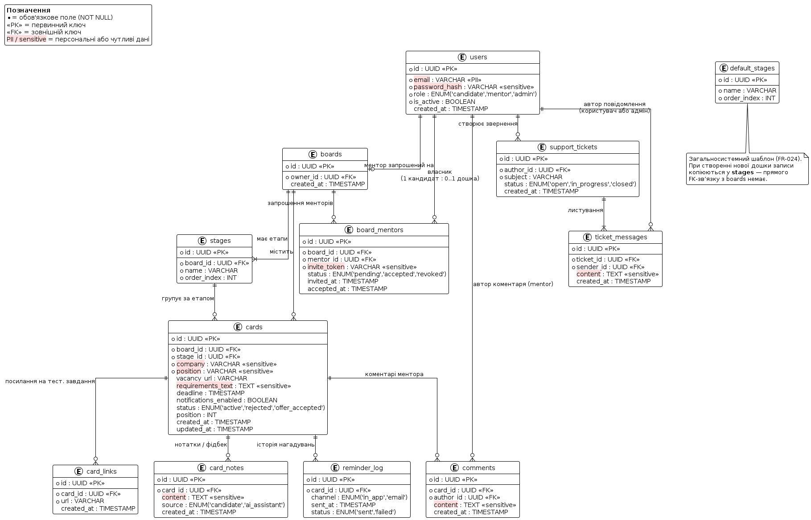

# Модель даних (Data Model)

Формат моделі: **ER-модель** (сутності, атрибути, зв'язки, кардинальність) — обрано відповідно до архітектурного рішення [ADR-002](decisions/ADR-002.md), яке фіксує PostgreSQL як реляційну базу даних проєкту.

Діаграма: [`uml/data-model.puml`](uml/data-model.puml) (рендер нижче).

## Які ключові функції покриває модель

|  | Функція (з опису проєкту) | Сутності, що її забезпечують |
|---|---|---|
| 1 | Реєстрація/автентифікація та ролі (FR-001, FR-002) | `users` |
| 2 | Канбан-дошка з переміщенням карток між етапами (FR-003–FR-006) | `boards`, `stages`, `default_stages`, `cards` |
| 3 | Створення і збереження картки вакансії: вимоги, посилання, дедлайн (FR-007–FR-010) | `cards`, `card_links` |
| 4 | Нотатки та фідбек від рекрутерів, включно з результатом AI-асистента (FR-011, FR-022) | `card_notes` |
| 5 | Запрошення ментора та його обмежений доступ (FR-012, FR-014, FR-015) | `board_mentors` |
| 6 | Коментарі ментора до картки (FR-013) | `comments` |
| 7 | Нагадування про дедлайни (FR-016–FR-018) | `cards` (поля `deadline`, `notifications_enabled`), `reminder_log` |
| 8 | Звернення в підтримку (FR-025) | `support_tickets`, `ticket_messages` |

## Довідник сутностей

| Сутність | Первинний ключ | Призначення |
|---|---|---|
| `users` | `id` | Обліковий запис (кандидат / ментор / адміністратор) |
| `boards` | `id` | Особиста Канбан-дошка кандидата (1 кандидат — 0..1 дошка) |
| `default_stages` | `id` | Глобальний шаблон стандартних етапів для нових дошок (FR-024); не має прямого FK до `boards` — значення копіюються в `stages` при створенні дошки |
| `stages` | `id` | Конкретні етапи дошки (Відгук, Скринінг, Технічне інтерв'ю, Офер тощо) |
| `cards` | `id` | Картка вакансії |
| `card_links` | `id` | Посилання на тестові завдання, привʼязані до картки (кілька на картку) |
| `card_notes` | `id` | Нотатки/фідбек по картці, включно зі згенерованими AI-асистентом (поле `source`) |
| `comments` | `id` | Коментарі ментора до картки |
| `board_mentors` | `id` | Звʼязок дошки з запрошеним ментором + статус запрошення |
| `reminder_log` | `id` | Історія фактично надісланих нагадувань і статус доставки (для REL-3) |
| `support_tickets` | `id` | Звернення в підтримку |
| `ticket_messages` | `id` | Листування в межах одного звернення (початкове повідомлення + відповіді) |

## Ключові звʼязки та кардинальність

- **users → boards** (1 : 0..1): кожен кандидат має щонайбільше одну дошку; ментори й адміністратори власної дошки не мають.
- **boards → stages** (1 : 1..N): дошка завжди має хоча б один етап (копіюється з `default_stages` при створенні).
- **stages → cards** (1 : 0..N): в етапі може не бути жодної картки.
- **cards → card_links / card_notes / comments / reminder_log** (1 : 0..N): картка може мати нуль або кілька повʼязаних записів кожного типу.
- **boards ↔ users через board_mentors** (M : N): один ментор може бути запрошений на кілька дошок, одна дошка може мати кількох менторів.
- **users → support_tickets → ticket_messages**: звернення завжди має щонайменше одне повідомлення (початкове), далі — довільна кількість відповідей від автора чи адміністратора.

## Персональні та чутливі дані
| Сутність.Поле | Тип | Чому це важливо |
|---|---|---|
| `users.email` | Персональне | Прямий ідентифікатор особи; використовується і для входу, і для запрошень |
| `users.password_hash` | Чутливе | Секрет доступу (не дані про людину); витік дозволяє offline brute-force |
| `board_mentors.invite_token` | Чутливе | Секрет доступу до чужої дошки без додаткової автентифікації |
| `cards.company`, `cards.position` | Персональне | Описують активність конкретного кандидата — куди саме він подається |
| `cards.requirements_text`, `card_notes.content`, `comments.content` | Персональне | Вміст, привʼязаний до конкретного кандидата (фідбек про нього) |
| `ticket_messages.content` | Персональне | Повідомлення від ідентифікованого користувача, може містити особисті деталі |

## Використання ШІ
- **Інструмент:** Claude
- **Застосування:** побудова ER-моделі даних; виявлення й позначення персональних/чутливих полів.
- **Верифікація:** модель звірена з переліком FR/NFR, traceability-matrix.md та архітектурними рішеннями в ADR-002
