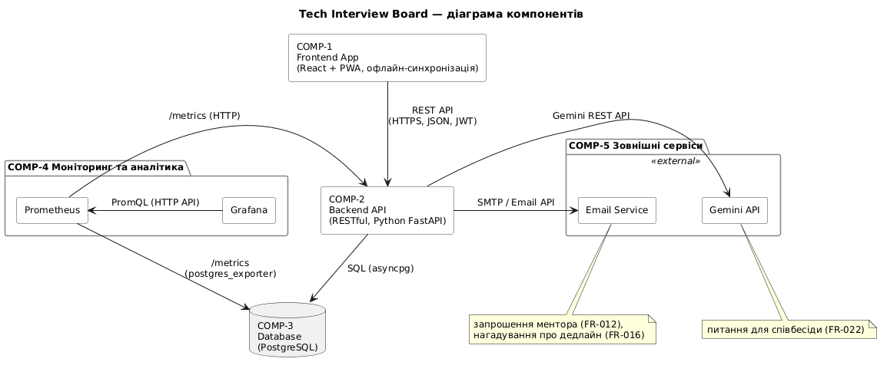

# Архітектурний огляд (High-Level Design)

Цей документ описує високорівневу архітектуру системи **Tech Interview Board**.

## Стан реалізації
На даний момент архітектуру реалізовано частково:
- **Реалізовано:** RESTful Backend API (FastAPI) та реляційну базу даних (PostgreSQL), базовий клієнтський додаток (React).
- **Заплановано:** Прогресивний вебзастосунок (PWA) з офлайн-режимом, підсистему моніторингу й аналітики (Prometheus і Grafana), AI асистент та сервіс сповіщень ще не імплементовано в коді.

## Архітектурний стиль

Для нашого проєкту ми обрали **Клієнт-серверну архітектуру з монолітним бекендом**.
Цей стиль найкраще підходить для нашої системи з огляду на наступне:
- **Швидкість розробки (Time-to-Market)**: Монолітний бекенд дозволяє команді розробити MVP у стислі терміни (10-11 тижнів).
- **Простота розгортання та підтримки**: На етапі прототипу нам не потрібна складна мікросервісна інфраструктура.
- **Характер навантаження**: Очікувана кількість користувачів та обсяг даних (кандидати, ментори, дошки вакансій) не вимагають горизонтального масштабування бекенду чи NoSQL баз даних на даному етапі.

## Ключові компоненти системи

Нижче наведено високорівневу діаграму компонентів, яка ілюструє взаємодію основних блоків системи:

Система складається з наступних основних логічних блоків:

### 1. Frontend App (Клієнтський додаток)
- **Технології**: React, PWA (Progressive Web App).
- **Опис**: Веб-інтерфейс, через який користувачі (Кандидати, Ментори, Адміністратори) взаємодіють із системою. Основний елемент — інтерактивна Канбан-дошка. Завдяки технології PWA підтримується кешування та базова робота при перебоях з мережею (офлайн-режим).
- **Зв'язок**: Спілкується з бекендом через RESTful API по протоколу HTTPS.

### 2. Backend API (Серверна частина)
- **Технології**: RESTful API (Python FastAPI).
- **Опис**: Центральний монолітний компонент, який містить усю бізнес-логіку. Відповідає за автентифікацію, авторизацію, обробку CRUD-операцій з картками вакансій, відправку нагадувань про дедлайни та взаємодію з AI.
- **Зв'язок**: Обробляє HTTP-запити від фронтенду, звертається до бази даних та зовнішніх сервісів.

### 3. Database (База даних)
- **Технології**: PostgreSQL.
- **Опис**: Реляційна база даних для надійного зберігання інформації (профілі користувачів, вакансії, етапи, нотатки, зв'язки між кандидатом та ментором). Структурований формат реляційної БД ідеально підходить для нашої моделі даних.

### 4. Моніторинг та Аналітика
- **Технології**: Prometheus + Grafana.
- **Опис**: Підсистема для збору технічних метрик (Prometheus) та їх графічної візуалізації (Grafana). Дозволяє команді відстежувати стан системи, час відповіді та виявляти проблеми.

### 5. Зовнішні сервіси (External Services)
- **AI-Асистент**: Інтеграція з зовнішнім API (Gemini) для генерації відповідей на тестові завдання та підготовки до співбесід.
- **Сервіс сповіщень**: Сторонній сервіс для відправки email-нагадувань про наближення дедлайнів.

## Архітектурні рішення (ADR)
Більш детально обґрунтування ключових технічних виборів описано у відповідних документах:
- [ADR-001: Вибір архітектури Frontend-додатку (React + PWA)](decisions/ADR-001.md)
- [ADR-002: Вибір архітектури Backend та Бази Даних (RESTful + Postgres)](decisions/ADR-002.md)
- [ADR-003: Вибір системи моніторингу (Prometheus + Grafana)](decisions/ADR-003.md)

## Використання ШІ

- **Інструмент:** Gemini
- **Застосування:** Допомога у формулюванні та структуруванні опису архітектури.
- **Верифікація:** Дизайн архітектури перевірений, скоригований та затверджений командою вручну.