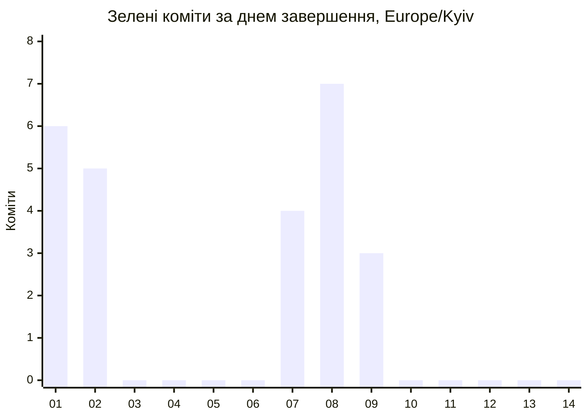
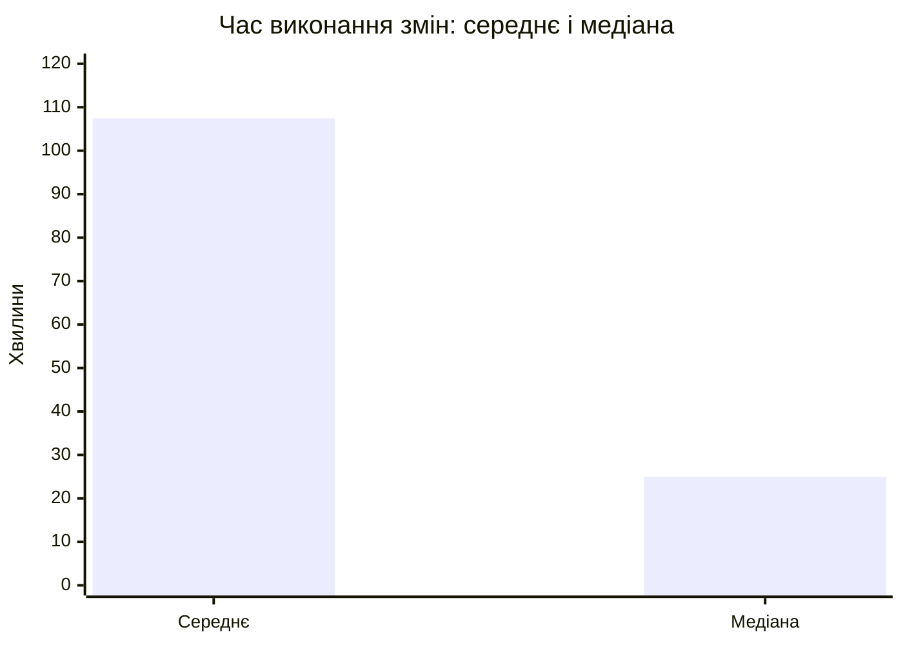
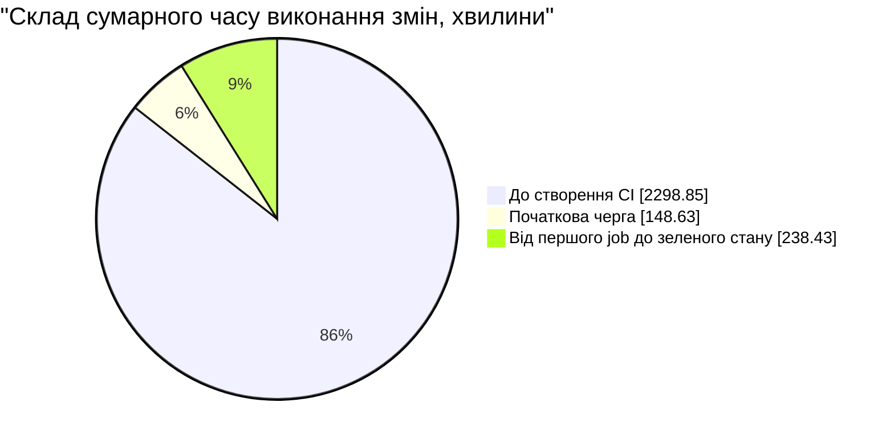
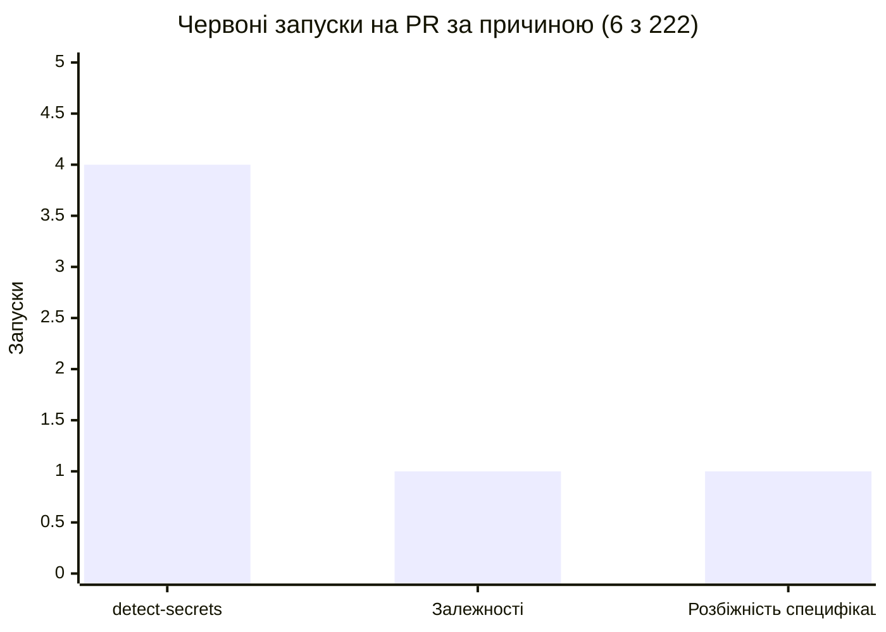

# Підсумок метрик DORA — Лабораторна 10

Основний період: **01.11–14.11.2026 включно, Europe/Kyiv**, рівно 14 діб. У вибірці **25 комітів, 93 workflow-запуски, 93 перші спроби**. Усі вони зелені. Дані: [metrics-raw.md](metrics-raw.md), [API snapshot](evidence/api-snapshot.json), [автоматичний результат](metrics-auto.md).

Попередні 23 коміти / 83 запуски не охоплювали перші дві години 1 листопада за Києвом. Оригінали збережено; усі розбіжності пояснено в [reconciliation.md](reconciliation.md).

## Визначення й методика

Розгортання — готовий до випуску зелений стан `main` за умовою лабораторної. Для одного SHA зеленими мають бути всі враховані workflow, які запустилися для нього: **CI**, **Static analysis**, **Lab07 card ordering**, **Lab08 characterization tests**, **Generate and Deploy API Docs**. Останні два мають умовні тригери за шляхами. Один SHA рахується один раз, а не як 3–5 розгортань.

Вибірка формується за створенням CI у `[2026-10-31T22:00:00Z, 2026-11-14T22:00:00Z)`, подія `push`, гілка `main`. Завершення після верхньої межі не враховуються; у фактичній вибірці таких або незавершених запусків немає. Повторних спроб, скасувань і червоних запусків також немає. Повні правила для цих випадків визначені у [README](README.md).

Ці метрики — **наближення до DORA через CI**, а не показники фактичного робочого середовища (production). Категорії DORA 2025 та орієнтири CircleCI нижче взято з таблиць умови лабораторної.

**Враховані workflow** (поточна конфігурація, тригер `push` на `main`):

| Workflow | Файл | Job | Коли запускається на `main` |
|----------|------|-----|-----------------------------|
| CI | [ci.yml](../../.github/workflows/ci.yml) | `build`, `Reliability tests` | на кожен push |
| Static analysis | [static-analysis.yml](../../.github/workflows/static-analysis.yml) | `lint-and-security` | на кожен push |
| Lab07 card ordering | [lab07-card-order.yml](../../.github/workflows/lab07-card-order.yml) | `postgres-card-order` | на кожен push |
| Lab08 characterization tests | [lab08-characterization.yml](../../.github/workflows/lab08-characterization.yml) | `invitation-characterization` | лише за змін у `src/frontend/**` або файлі цього workflow |
| Generate and Deploy API Docs | [deploy-api-docs.yml](../../.github/workflows/deploy-api-docs.yml) | `generate-and-deploy` | лише за змін у `src/api/**`, `docs/api/**`, `requirements.txt` |

Не враховано службові запуски GitHub, що не є нашими перевірками: `Dependency Graph` і `Dependabot Updates` (подія `dynamic`).

## Чотири метрики

| Метрика | Формула | Результат | Категорія DORA 2025: частка з таким або кращим результатом |
|---|---|---|---|
| Частота розгортань | 25 зелених SHA / 2 тижні | **12,50 / тиждень**, 1,79 / день | За середньою частотою: від щогодини до щодня → **22,7%** |
| Час виконання змін | Перший коміт PR (за датою автора) → завершення останнього job зеленого SHA | Середнє **107,44 хв**, медіана **24,97 хв** | За середнім: менше доби → **24,4%**; за медіаною: менше години → **9,4%** |
| Частота збоїв змін | 0 невдалих SHA / 25 завершених SHA × 100% | **0%** | 0–2% → **8,5%** |
| Час відновлення | Перший червоний стан SHA → наступний зелений main; середнє й медіана | **н/д**, жодного збою у вибірці | н/д; відсутність інцидентів не означає миттєве відновлення |

Частота нерівномірна: зелені завершення були лише у **5 із 14 днів**. Категорія за середнім не означає щоденної доставки. Дні визначаються завершенням останнього job у київському часі.

## Порівняння з орієнтирами CircleCI

| Показник | Рекомендований орієнтир | Дані 2025 з умови | Наш результат |
|---|---|---|---|
| Частка успішних запусків основної гілки | 90% | 70,8% | **100%: 93/93 workflow**, також 25/25 SHA |
| Повернення main до зеленого стану | До 60 хв | Медіана 59,2 хв | **н/д** у листопадовій вибірці |
| Тривалість виконання workflow | До 10 хв | Медіана 2,2 хв | **Медіана 0,90 хв, максимум 3,80 хв** |

Останній рядок використовує інтервали **окремих workflow**. Інтервал від першого до останнього job усіх workflow одного SHA має медіану **1,80 хв** і максимум **103,15 хв**. Він включає внутрішні паузи й не є тривалістю одного тесту або workflow.

## Склад часу виконання змін

| Частина | Сума, хв | Частка від сумарного часу виконання змін |
|---|---:|---:|
| Від першого коміту до створення CI | **2298,85** | **85,59%** |
| Початкова черга до першого job | **148,63** | **5,53%** |
| Від першого job до зеленого стану всіх workflow | **238,43** | **8,88%** |
| Повний час виконання змін | **2685,92** | **100%** |

У межах CI початкова черга займає **38,40%**, інтервал після першого job — **61,60%**. Сумарне об'єднання інтервалів jobs становить **59,87 хв**, внутрішні проміжки без активного job відповідного SHA — **178,57 хв**. Ці суми рахуються окремо для кожної зміни, а не як загальне завантаження інфраструктури.

Для PR **#198**, SHA `3184d4f`, початкова черга — **26 хв 20 с**, інтервал після першого job — **103 хв 9 с**. Усередині нього jobs цього SHA займали **8 хв 27 с**, а проміжки між ними — **94 хв 42 с**. Це підтверджує очікування між jobs. Конкуренція за спільні раннери є гіпотезою причини, узгодженою з конфігурацією; snapshot не містить навантаження інших команд.

## Аналіз парами

**Швидкість і стабільність.** 12,5 зелених змін на тиждень та 0% збоїв показують успішне проходження врахованих перевірок. Середній час виконання змін у 4,3 раза більший за медіану: кілька довгих змін сильно впливають на середнє. Для #194 від першого коміту до зеленого main минуло майже 10 годин, тоді як після створення CI — 59 секунд. Варто виміряти процес до CI, зберігаючи перевірки стабільності.

**Частота збоїв і відновлення.** 0% у 25 змінах не доводить відсутності ризику й не дає оцінити здатність відновлювати main. Поза основним періодом є інфраструктурний інцидент із відновленням за 4 дні 21 год 45 хв 39 с; його використовуємо для покращення реагування, не змішуючи з листопадовими метриками.

## Першопричини

**Технічні спостереження:** кілька workflow одного SHA працюють на self-hosted раннерах курсу, спільних для всіх команд і не підконтрольних нам; у піку початкова черга перевищує 54 хв, а між jobs виникають довгі паузи. Дані не вказують на окремий повільний workflow: максимум виконання — 3,80 хв.

**Організаційні спостереження:** 85,59% часу виконання змін припадає на період до створення CI, розгортання згруповані у п'ять днів. Цей час охоплює розробку, огляд, очікування злиття, а також очікування PR-перевірок у черзі на раннери курсу (див. розбір п'яти найдовших PR нижче); даних недостатньо, щоб приписати його лише повільному огляду або роботі перед дедлайном.

### Додаткові результати командного аналізу

У [PR #235](https://github.com/ukma-fin-ssdm-2026/Monkey-Business-project/pull/235) команда перевірила зміни файлів, невдалі PR-запуски й правила гілки. Нижче внесок узгоджено з уточненою основною вибіркою.

- **12 із 25 комітів (48%) змінюють лише документацію** (`docs/`, `Labs/`, `*.md`): PR #194, #199, #200, #201, #219, #220, #221, #222, #223, #227, #229, #230. Перелік повторно перевірено через `git diff --name-only <sha>^1 <sha>`. Зокрема #199 і #200 чекали до першого job понад 54 хвилини, хоча це документаційні зміни.
- **У збереженій історичній вибірці один SHA має від 3 до 5 jobs.** Перелік jobs поточної конфігурації вище не слід механічно переносити на кожен історичний запуск. Повторне встановлення залежностей і відсутність `concurrency` у поточних основних workflow — конкретні місця для оптимізації, але їхній ефект потрібно виміряти.
- **П'ять PR #194, #229, #199, #230, #200 дають близько 68,2% сумарного часу виконання змін** уточненої вибірки. Таймінги їхніх PR-перевірок (GitHub Actions API, jobs) показують дві різні причини:
  - **#199 і #200 — черга на спільних раннерах курсу у вечір дедлайну 01.11.** Їхні PR-перевірки чекали на раннер 47–216 хв, а виконувалися 1–2 хв: `build` у #199 — у черзі 22:50, старт 00:11 ([запуск](https://github.com/ukma-fin-ssdm-2026/Monkey-Business-project/actions/runs/41348876878)); `build` у #200 — у черзі 23:53, старт 03:29 ([запуск](https://github.com/ukma-fin-ssdm-2026/Monkey-Business-project/actions/runs/41354259682)). Після злиття запуск на `main` чекав раннер ще по 54 хв. Ці раннери обслуговують усі команди курсу; команда ними не керує.
  - **#194, #229, #230 — очікування злиття.** PR-перевірки були зелені через 1–24 хв після відкриття PR, а злиття відбулося через ≈ 5–10 год: #194 відкрито о 02:06, злито о 12:02; #229 і #230 злито разом о 15:08.
  
  Отже, «час до створення CI» на `main` містить не лише розробку й огляд, а й очікування PR-перевірок у черзі на раннери курсу.
- **За перевіркою правил гілки у PR #235**, required checks: `build`, `Reliability tests`, `lint-and-security`, `SonarCloud Code Analysis`; `postgres-card-order` і Lab08 не були required, `strict_required_status_checks_policy` було вимкнено. Це стан під час командної перевірки, не гарантія незмінності налаштувань GitHub. Перед упровадженням відповідних дій їх потрібно перечитати.

## Огляд інцидентів

У листопадовій вибірці немає червоних запусків, тому для неї немає причин збоїв чи виміряного часу відновлення.

Окремо підготовлено [розбір інциденту 18–23 жовтня без пошуку винних](incident-review.md). Анотації GitHub підтверджують, що `CI` і `Static analysis` не запустили jobs через обмеження оплати або spending limit для GitHub-hosted раннерів. Наступний зелений SHA містить перехід на self-hosted раннери курсу. Запит логів завдань повертає 404; причина підтверджена збереженими анотаціями.

### Що зупинили PR-перевірки

Окрема перевірка команди у PR #235 знайшла **6 червоних із 222 PR-запусків (2,7%) у чотирьох PR** за її вибіркою. Ці запуски не додаються до 93 запусків `push` на `main` і не входять до частоти збоїв змін DORA. Причини та посилання збережено з командного аналізу:

| PR | Запуск (час за Києвом) | Перевірка | Причина з логу | Що це означає |
|----|------------------------|-----------|----------------|---------------|
| #192 | [41247298083](https://github.com/ukma-fin-ssdm-2026/Monkey-Business-project/actions/runs/41247298083) (01.11 00:14) | CI → `build`, встановлення залежностей | `No matching distribution found for mutmut==2.5.1`: такої версії немає в PyPI | неіснуючу версію залежності помітили до злиття |
| #192 | [41248811331](https://github.com/ukma-fin-ssdm-2026/Monkey-Business-project/actions/runs/41248811331) (01.11 00:34) | CI → `build`, `Check for spec drift` | `docs/api/openapi-generated.yaml` у PR відрізнявся від згенерованого (вручну додано коментар-заголовок) | перевірка розбіжності специфікації працює |
| #202 | [41406965138](https://github.com/ukma-fin-ssdm-2026/Monkey-Business-project/actions/runs/41406965138) (02.11 09:32) | Static analysis → `detect-secrets` | `Secret Keyword` у `tests/reliability/test_database_failure.py:22` | тестовий пароль без позначки `pragma: allowlist secret` |
| #216 | [42358889467](https://github.com/ukma-fin-ssdm-2026/Monkey-Business-project/actions/runs/42358889467), [42359087655](https://github.com/ukma-fin-ssdm-2026/Monkey-Business-project/actions/runs/42359087655) (07.11 11:14, 11:17) | Static analysis → `detect-secrets` | `Secret Keyword` у `src/frontend/tests/reliability.test.tsx:56` і `:73` | те саме: тестові облікові дані, два запуски поспіль |
| #218 | [42387342929](https://github.com/ukma-fin-ssdm-2026/Monkey-Business-project/actions/runs/42387342929) (07.11 17:38) | Static analysis → `detect-secrets` | `The baseline file was updated. Please git add .secrets.baseline` | `.secrets.baseline` змінився, але його не закомітили |

Із цих шести невдалих PR-запусків чотири пов'язані з `detect-secrets`. Перелічені проблеми усунено до відповідних зелених станів `main`; це свідчить про користь перевірок для цих випадків, але не доводить відсутності будь-яких інших дефектів. Локальний запуск тих самих хуків pre-commit дозволяє раніше отримувати цей зворотний зв'язок; сама наявність збою в CI не доводить, що конкретний учасник не запускав хуки локально.

## Який біль у нашій команді показали ці метрики?

**Ми доставляємо сплесками.** Зелені зміни були лише у 5 із 14 днів: 11 із 25 припали на 01–02.11, а з 10.11 по 14.11 не було жодної. Вечір 01.11 збігся з дедлайном усього курсу, коли спільні раннери курсу мали багатогодинну чергу.

**Зміни довго чекають — з двох різних причин.** Окремий workflow виконується за медіанні 0,90 хв, але 85,59% часу виконання змін минає до створення CI на `main`. Для #199 і #200 це черга на раннерах курсу, яку команда не контролює: PR-перевірки чекали раннер 47–216 хв, хоча виконувалися 1–2 хв. Для #194, #229 і #230 перевірки були зелені за хвилини, а PR чекали на злиття 5–10 годин — це вже наш процес. Очікування змушує повертатися до контексту PR пізніше й ускладнює прогнозування готовності до випуску.

**Спільні раннери зайняті тим, що можна перевірити раніше.** 12 із 25 змін торкаються лише документації, але кожна запускає перевірки на спільних раннерах. 4 із 6 червоних запусків на PR — `detect-secrets`, який можна запустити локально через pre-commit.

**Ми залежимо від інфраструктури раннерів і не маємо порядку реагування.** Історичний збій показав, що навіть коректний код не отримує зелених перевірок, якщо jobs не стартують, і тоді `main` лишається червоним днями. Потрібен визначений відповідальний, сповіщення про червоний `main` і порядок реагування.

## План покращень (Improvement Backlog)

Це пропозиції команди, а не заяви про вже впроваджені зміни або виміряний ефект. Виняток — рядок про PostgreSQL-перевірку: рішення за ним змінено й упроваджено в бонусі «Швидкий і повільний набори тестів».

«Уся команда» означає, що дію виконує кожен учасник (@punguiin, @saoleksii, @MykolaVashchenko, @mytec0l) у своїх PR; координатор нагадує про домовленість і перевіряє її ефект на наступному вимірюванні.

| Метрика | Проблема / доказ | Причина або гіпотеза | Дія | Відповідальний |
|---|---|---|---|---|
| Частота розгортань | Зелені зміни лише у 5/14 днів; 10–14.11 — жодної | Робота завершується групами; зв'язок із дедлайнами варто обговорити | Внутрішній дедлайн за 2 дні до пари; прагнути зливати готові невеликі PR у будні дні | уся команда (координує @punguiin) |
| Частота розгортань | 11/25 зелених змін припали на 01–02.11 | Завдання можуть бути надто великими для частих злиттів | Розбивати лабораторну на 2–3 PR: дані → розрахунки → висновки; зливати кожен, щойно він готовий | уся команда (координує @saoleksii) |
| Час виконання змін | #199 і #200: PR-перевірки 47–216 хв у черзі, виконання — 1–2 хв; на `main` — ще по 54 хв черги | Спільні раннери курсу перевантажені у вечір дедлайну для всіх команд; цей сервер не наш, і вплинути на нього команда не може | Не потрапляти в пік: зливати PR до вечора дедлайну курсу; про багатогодинну чергу повідомляти викладачам курсу | уся команда (координує й повідомляє викладачам @saoleksii) |
| Час виконання змін | #194, #229, #230: перевірки зелені за 1–24 хв, злиття — через ≈ 5–10 год | PR чекають на злиття після зелених перевірок; #229 і #230 злито разом | Draft PR після першого коміту, огляд і злиття протягом робочого дня, черговий рецензент на тиждень; окремо виміряти час від зелених перевірок до злиття | уся команда (координує @saoleksii) |
| Час виконання змін | 12/25 змін — документація; #199 і #200 чекали понад 54 хв | Черга на спільних раннерах курсу; документаційні зміни додають до неї наші jobs | Lab07 (`postgres-card-order`) не є required check і після бонусу запускається лише на `main`, тож для нього можна додати `paths-ignore` для документації. Для required checks (`build`, `Reliability tests`, `lint-and-security`) пропускати непотрібні кроки всередині job, бо фільтр на рівні workflow залишив би check у стані «Expected — waiting» | @MykolaVashchenko |
| Час виконання змін | Для #198 — 94 хв 42 с внутрішніх пауз | Конкуренція за раннери; зайве встановлення залежностей і застарілі PR-запуски | `concurrency` з `cancel-in-progress: true` для PR; кеш pip/npm; ефект перевірити тим самим вимірюванням | @MykolaVashchenko |
| Час виконання змін | 4 з 6 розібраних червоних PR-запусків — detect-secrets | Локальне виявлення проблем можна зробити ранішим | Додати `pre-commit install` до інструкції команди і запускати хуки локально перед push; тестові дані та хибні спрацювання позначати лише після перевірки | уся команда (інструкція — @MykolaVashchenko) |
| Частота збоїв змін | 0% у вибірці не доводить нульового ризику; злиття групуються | За командним аудитом гілка PR могла бути неактуальною щодо main | Перевірити поточні rules і ввімкнути вимогу «Require branches to be up to date before merging» | @mytec0l |
| Частота збоїв змін | PostgreSQL-перевірка не була required за аудитом PR #235 | Невдала інтеграційна перевірка могла не блокувати злиття | **Змінено рішення:** замість required check повільний набір винесено на `main` (див. «Бонуси»), щоб менше навантажувати спільні раннери. Перед злиттям змін у `src/api/repositories/`, `migrations/` чи `tests/integration/` запускати його вручну (`workflow_dispatch`); червоний `postgres-card-order` на `main` обробляти за правилом відновлення (60 хв) | @MykolaVashchenko |
| Частота збоїв змін | 0% не доводить повноти перевірок | Ризик непокритих дефектів | Перевірити, що reliability checks потрібних змін є required і не обходяться | @MykolaVashchenko |
| Частота збоїв змін | Історична відмова запуску раннера | Залежність від GitHub-hosted раннерів | Перевіряти потрібні runner labels в огляді workflow та актуальність branch protection | @mytec0l |
| Час відновлення | Історичний main був червоним майже 5 діб | Потрібен явний порядок реагування | Черговий за конвеєром на тиждень; runbook доступності раннерів; ціль revert або виправлення протягом 60 хв | @mytec0l |
| Час відновлення | Відмову запуску jobs можна помітити пізно | Сповіщення й ескалація потребують перевірки | Перевірити або налаштувати сповіщення про `failure` на main у командний чат та передачу черговому | @punguiin |

## Дашборд DORA

| Частота розгортань | Час виконання змін | Частота збоїв змін | Час відновлення |
|:------------------:|:------------------:|:------------------:|:---------------:|
| **12,5 / тиждень**<br>зелені лише у 5 із 14 днів | **медіана 24,97 хв**<br>середнє 107,44 хв | **0%**<br>0 з 25 | **н/д**<br>червоних запусків не було |
| від щогодини до щодня → 22,7% | менше години → 9,4% (за медіаною) | 0–2% → 8,5% | — |



Частота розгортань нерівномірна: 11 із 25 зелених змін припали на 01–02.11, а з 10.11 по 14.11 не було жодної.



Середнє в 4,3 раза більше за медіану: п'ять довгих PR дають близько 68,2% сумарного часу виконання змін. Два з них (#199, #200) затримала черга на раннерах курсу, три (#194, #229, #230) — очікування злиття.



85,59% часу зміна проводить до створення CI; черга й виконання разом — 14,41%.



Стабільність: **25/25 зелених змін на `main`, частота збоїв змін 0%**; усі 6 дефектів зупинено на PR до злиття. Для часу відновлення графік не будується, бо в основній вибірці немає спостережень.

**Ключовий висновок:** окремі workflow виконуються швидко (медіана 0,90 хв), але 85,59% часу виконання змін виникає до створення CI, а в піках доводиться довго чекати між jobs.

**Одна дія на наступний тиждень:** відкривати draft PR після першого коміту та застосувати домовленість про огляд протягом робочого дня. Повторити вимірювання за такою самою методикою; оцінити медіану часу виконання змін разом із частотою збоїв змін.

## Використання ШІ

Командні workflow-таблиця, PR-інциденти, аудит правил і план покращень із PR #235 підготовлені з допомогою Claude Code; їх інтегровано зі збереженням авторських відповідальних і уточненням чисел за новою вибіркою. Попередній командний звіт створено з допомогою Copilot; його копія збережена в [manual-baseline](evidence/manual-baseline/dora-summary.md). Codex використано для автоматизації, API-збору, тестів, перерахунку й уточнення висновків. Контрольні приклади наведено в [reconciliation.md](reconciliation.md).

Упорядкування звіту з допомогою Claude Code: повернення розділів PR #235, які випали під час rebase гілки автоматизації, зведена таблиця й графік стабільності в дашборді, розділ «Який біль у нашій команді показали ці метрики?», єдина українська термінологія. Числа перенесено з таблиць звіту та [metrics-auto.md](metrics-auto.md) без змін.

Бонус «Пошук нестабільних тестів»: workflow, скрипт порівняння й тести до нього підготовлені з допомогою Claude Code. Цикл workflow прогнано локально проти PostgreSQL 16, зокрема зі штучно нестабільним тестом; список повторних запусків на `main` звірено з API-доказами та повторним запитом до GitHub API.

## Бонуси

### Швидкий і повільний набори тестів (§2.3.6)

**Що зроблено:** з [lab07-card-order.yml](../../.github/workflows/lab07-card-order.yml) прибрано тригер `pull_request`; додано `workflow_dispatch` для ручного запуску. Більше нічого змінювати не довелося: інтеграційні тести вже пропускаються без `TEST_DATABASE_URL`, тому в job `build` вони не виконуються.

| Набір | Що входить | Де запускається | Залежність | Workflow → job |
|-------|------------|-----------------|------------|----------------|
| Швидкий | модульні тести й тести API через `TestClient` із репозиторієм у пам'яті (`tests/`, крім тестів, що потребують PostgreSQL), поріг покриття 70% | кожен PR і кожен push у `main` | немає | CI → `build` |
| Повільний | `tests/integration/` (TP-02, TP-06, TP-10, TP-11) і `tests/test_card_order_postgres.py` (TP-04); job також повторно запускає `tests/test_card_order.py`, який уже входить у швидкий набір | лише push у `main` і вручну (`workflow_dispatch`) | **PostgreSQL 16 у контейнері** (`services: postgres`), схема — міграціями Alembic | Lab07 card ordering → `postgres-card-order` |

**Як поділ працює технічно:** фікстури в [tests/integration/conftest.py](../../tests/integration/conftest.py) і [tests/test_card_order_postgres.py](../../tests/test_card_order_postgres.py) викликають `pytest.skip`, якщо не задано `TEST_DATABASE_URL`. У `build` змінна не задана, тож ці тести пропускаються; у `postgres-card-order` вона вказує на сервісний контейнер PostgreSQL.

**Докази:**

| Запуск | Посилання | Набори | Тривалість |
|--------|-----------|--------|------------|
| PR лише зі швидким набором | [CI на PR #237](https://github.com/ukma-fin-ssdm-2026/Monkey-Business-project/actions/runs/43745464196) | швидкий (`postgres-card-order` серед перевірок PR відсутній) | `build` — 1 хв 3 с, з них тести — 20 с |
| `main` з обома наборами (коміт злиття #237) | [CI](https://github.com/ukma-fin-ssdm-2026/Monkey-Business-project/actions/runs/43746047102), [Lab07 card ordering](https://github.com/ukma-fin-ssdm-2026/Monkey-Business-project/actions/runs/43746047128) | швидкий + повільний | `build` — 1 хв 5 с (тести — 20 с); `postgres-card-order` — 58 с (тести — 4 с) |

Орієнтир до зміни (3 останні запуски на `main`): job `postgres-card-order` — 56–91 с, з них самі тести — 5–12 с. Решта — старт контейнера PostgreSQL і встановлення залежностей. Поділ звільняє один раннер приблизно на хвилину на кожен push у PR.

**Ціна поділу:** дефект, який ловить лише повільний набір, тепер з'явиться як червоний запуск на `main` і увійде в частоту збоїв змін (див. рядок про PostgreSQL-перевірку в плані покращень).

### Автоматичний підрахунок метрик — +0,25 бала

Внесок **@mytec0l — аналітик даних CI/CD**:

- Додано [локальний скрипт](../../scripts/calculate_ci_metrics.py), який читає GitHub Actions REST API, jobs і PR commits за заданий період, зберігає докази та обчислює всі чотири метрики.
- Черга й виконання зберігаються окремо; workflow об'єднуються за SHA; усі attempts зберігаються, невідома метрика не підмінюється нулем.
- Результат: [metrics-auto.md](metrics-auto.md), [metrics-auto.json](metrics-auto.json); докази: [api-snapshot.json](evidence/api-snapshot.json).
- Порівняння з ручним Етапом 2 та контрольні приклади: [reconciliation.md](reconciliation.md).
- Скрипт протестовано; він запускається локально й не використовує спільні раннери або розклад.
- Пояснення роботи скрипта та демонстрація у відео: [Loom відео @mytec0l](https://www.loom.com/share/e0bbbd7d32a841d9ae8051fec8092811) (файл [video_NikitaDyshlyuk.txt](../../Labs/Lab10/video_NikitaDyshlyuk.txt)).

Команда фактичного збору з кореня репозиторію:

```powershell
.\.venv\Scripts\python.exe scripts/calculate_ci_metrics.py --from 2026-11-01 --to 2026-11-15 --timezone Europe/Kyiv --git-auth
```

Відтворення без мережі:

```powershell
.\.venv\Scripts\python.exe scripts/calculate_ci_metrics.py --offline
```

### Пошук нестабільних тестів

Внесок **@punguiin — відповідальний за документацію**.

**Що зроблено:**

- Workflow [Lab10 flaky tests](../../.github/workflows/lab10-flaky-tests.yml) запускається **лише вручну** (`workflow_dispatch`). В одному завданні `flaky-tests`, без матриці, він циклом виконує повний набір тестів 5 разів на одному коміті (параметр `repeats`, від 5 до 10). Повний набір — це `pytest` по всьому `tests/`, разом з інтеграційними тестами проти PostgreSQL 16 у сервісному контейнері на тому самому раннері, і Vitest-тести фронтенду.
- Скрипт [find_flaky_tests.py](../../scripts/find_flaky_tests.py) порівнює JUnit-звіти повторів і виводить у підсумок запуску (Job summary) список тестів, результат яких між повторами відрізнявся, з результатом кожного повтору. Тест, якого немає в одному з повторів, теж вважається відмінністю. Окремо скрипт показує тести, що падають у кожному повторі. Якщо є хоча б один такий тест, job завершується червоним. JUnit-звіти всіх повторів зберігаються як артефакт `lab10-flaky-tests`.
- Тести скрипта на синтетичних звітах: [test_find_flaky_tests.py](../../tests/test_find_flaky_tests.py).
- Навантаження на спільні раннери: один запуск займає один раннер; `concurrency` ставить повторний ручний запуск у чергу, а не на другий раннер; `timeout-minutes: 30`.

**Як запустити:** Actions → «Lab10 flaky tests» → Run workflow → гілка `main`. Ручний запуск з'являється в Actions лише після злиття файлу workflow у `main`.

**Повторні запуски на `main` за період Етапу 1 (01–14.11.2026), що стали зеленими без зміни коду: немає.** Усі 93 запуски `push` на `main` за цей період мають `run_attempt` = 1 і `conclusion` = `success`. Це видно в [api-snapshot.json](evidence/api-snapshot.json) (поле `runs[].run_attempt`, зібрано 15.11) і підтверджено повторним запитом до GitHub Actions API 16.11 з тим самим фільтром: `branch=main`, `event=push`, `created=2026-10-31T22:00:00Z..2026-11-14T21:59:59Z`. Перевірка без мережі:

```bash
python -c "import json; runs = json.load(open('docs/ci-cd/evidence/api-snapshot.json'))['runs']; print(len(runs), [r['html_url'] for r in runs if r['run_attempt'] > 1])"
# 93 []
```

**Результат пошуку:**

| Запуск | Повторів | Тестів у повторі | Результат відрізнявся | Тривалість |
|---|---|---|---|---|
| GitHub Actions на `main` | 5 | _після запуску_ | _після запуску_ | _після запуску_ |
| Локальна репетиція 16.11: кроки `run` цього workflow через `bash -e`, PostgreSQL 16 у Docker | 5 | 352 (334 pytest + 18 Vitest), пропущених 0 | **0** | ≈ 1,5 хв на 5 повторів |

**Контрольна перевірка:** у копію репозиторію тимчасово додано тест, який падає на парних повторах. Цикл не зупинився після невдалих повторів 2 і 4, а скрипт вивів саме цей тест (`пройдено | впав | пройдено | впав | пройдено`) і завершився з кодом 1. У репозиторій цей тест не додано.

**Якщо нестабільний тест знайдено:** виправити його або винести в карантин з issue, у якому названо причину з логу, і повторити запуск.

**Межі методу:** у кожному повторі тести йдуть у тому самому порядку, а кеш pytest вимкнено. Тому пошук виявляє нестабільність через час, випадкові дані чи зовнішній стан (база даних, мережа), але не залежність від порядку тестів.

**Статус:** технічні артефакти бонусу підготовлено й перевірено локально. Для зарахування ще потрібні посилання на запуск на `main` у таблиці вище та пояснення у відео хоча б одного учасника. Бонус поки не заявляється як зарахований.
