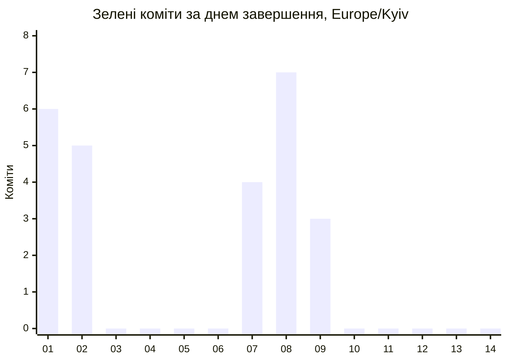
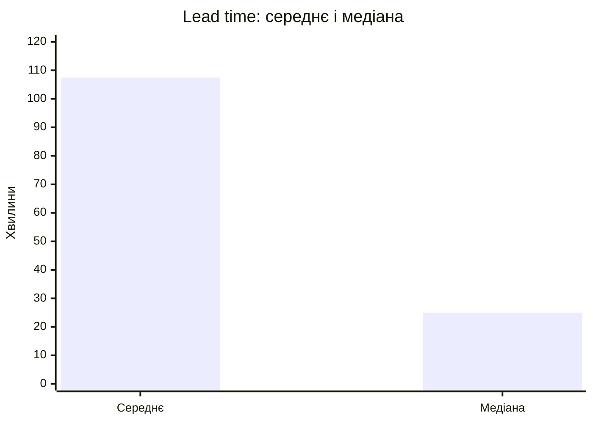
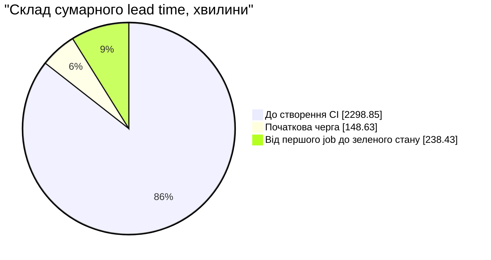

# Підсумок метрик DORA — Лабораторна 10

Основний період: **01.11–14.11.2026 включно, Europe/Kyiv**, рівно 14 діб. У вибірці **25 комітів, 93 workflow-запуски, 93 перші спроби**. Усі вони зелені. Дані: [metrics-raw.md](metrics-raw.md), [API snapshot](evidence/api-snapshot.json), [автоматичний результат](metrics-auto.md).

Попередні 23 коміти / 83 запуски не охоплювали перші дві години 1 листопада за Києвом. Оригінали збережено; усі розбіжності пояснено в [reconciliation.md](reconciliation.md).

## Визначення й методика

Розгортання — готовий до випуску зелений стан `main` за умовою лабораторної. Для одного SHA зеленими мають бути всі враховані workflow, які запустилися для нього: **CI**, **Static analysis**, **Lab07 card ordering**, **Lab08 characterization tests**, **Generate and Deploy API Docs**. Останні два мають умовні тригери за шляхами. Один SHA рахується один раз, а не як 3–5 розгортань.

Вибірка формується за створенням CI у `[2026-10-31T22:00:00Z, 2026-11-14T22:00:00Z)`, подія `push`, гілка `main`. Завершення після верхньої межі не враховуються; у фактичній вибірці таких або незавершених запусків немає. Повторних спроб, скасувань і червоних запусків також немає. Повні правила для цих випадків визначені у [README](README.md).

Ці метрики — **наближення до DORA через CI**, а не показники фактичного production. Категорії DORA 2025 та орієнтири CircleCI нижче взято з таблиць умови лабораторної.

## Чотири метрики

| Метрика | Формула | Результат | Категорія DORA 2025: частка з таким або кращим результатом |
|---|---|---|---|
| Частота розгортань | 25 зелених SHA / 2 тижні | **12,50 / тиждень**, 1,79 / день | За середньою частотою: від щогодини до щодня → **22,7%** |
| Час виконання змін | Перший authored commit PR → завершення останнього job зеленого SHA | Середнє **107,44 хв**, медіана **24,97 хв** | За середнім: менше доби → **24,4%**; за медіаною: менше години → **9,4%** |
| Частота збоїв змін | 0 невдалих SHA / 25 завершених SHA × 100% | **0%** | 0–2% → **8,5%** |
| Час відновлення | Перший червоний стан SHA → наступний зелений main; середнє й медіана | **н/д**, жодного збою у вибірці | н/д; відсутність інцидентів не означає миттєве відновлення |

Частота нерівномірна: зелені завершення були лише у **5 із 14 днів**. Категорія за середнім не означає щоденної доставки. Дні визначаються завершенням останнього job у київському часі.

## Порівняння з орієнтирами CircleCI

| Показник | Рекомендований орієнтир | Дані 2025 з умови | Наш результат |
|---|---|---|---|
| Частка успішних запусків основної гілки | 90% | 70,8% | **100%: 93/93 workflow**, також 25/25 SHA |
| Повернення main до зеленого стану | До 60 хв | Медіана 59,2 хв | **н/д** у листопадовій вибірці |
| Тривалість виконання workflow | До 10 хв | Медіана 2,2 хв | **Медіана 0,90 хв, максимум 3,80 хв** |

Останній рядок використовує інтервали **окремих workflow**. Інтервал від першого до останнього job усіх workflow одного SHA має медіану **1,80 хв** і максимум **103,15 хв**. Він включає внутрішні паузи й не є тривалістю одного тесту або workflow.

## Склад часу виконання змін

| Частина | Сума, хв | Частка від сумарного lead time |
|---|---:|---:|
| Від першого коміту до створення CI | **2298,85** | **85,59%** |
| Початкова черга до першого job | **148,63** | **5,53%** |
| Від першого job до зеленого стану всіх workflow | **238,43** | **8,88%** |
| Повний lead time | **2685,92** | **100%** |

У межах CI початкова черга займає **38,40%**, інтервал після першого job — **61,60%**. Сумарне об'єднання інтервалів jobs становить **59,87 хв**, внутрішні проміжки без активного job відповідного SHA — **178,57 хв**. Ці суми рахуються окремо для кожної зміни, а не як загальне завантаження інфраструктури.

Для PR **#198**, SHA `3184d4f`, початкова черга — **26 хв 20 с**, інтервал після першого job — **103 хв 9 с**. Усередині нього jobs цього SHA займали **8 хв 27 с**, а проміжки між ними — **94 хв 42 с**. Це підтверджує очікування між jobs. Конкуренція за спільні раннери є гіпотезою причини, узгодженою з конфігурацією; snapshot не містить навантаження інших команд.

## Першопричини й аналіз парами

**Швидкість і стабільність.** 12,5 зелених змін на тиждень та 0% збоїв показують успішне проходження врахованих перевірок. Середній lead time у 4,3 раза більший за медіану: кілька довгих змін сильно впливають на середнє. Для #194 від першого коміту до зеленого main минуло майже 10 годин, тоді як після створення CI — 59 секунд. Варто виміряти процес до CI, зберігаючи перевірки стабільності.

**Частота збоїв і відновлення.** 0% у 25 змінах не доводить відсутності ризику й не дає оцінити здатність відновлювати main. Поза основним періодом є інфраструктурний інцидент із відновленням за 4 дні 21 год 45 хв 39 с; його використовуємо для покращення реагування, не змішуючи з листопадовими метриками.

**Технічні спостереження:** кілька workflow одного SHA працюють на спільних self-hosted runners; у піку початкова черга перевищує 54 хв, а між jobs виникають довгі паузи. Дані не вказують на окремий повільний workflow: максимум виконання — 3,80 хв.

**Організаційні спостереження:** 85,59% lead time припадає на період до створення CI, розгортання згруповані у п'ять днів. Цей час охоплює розробку, review та очікування злиття; даних недостатньо, щоб приписати його лише повільному review або роботі перед дедлайном.

## Огляд інцидентів

У листопадовій вибірці немає червоних запусків, тому для неї немає причин збоїв чи виміряного recovery time.

Окремо підготовлено [blameless-розбір інциденту 18–23 жовтня](incident-review.md). Annotations GitHub підтверджують, що `CI` і `Static analysis` не запустили jobs через обмеження оплати/spending limit GitHub-hosted runners. Наступний зелений SHA містить перехід на self-hosted runners. Job logs повертає 404; причина підтверджена збереженими annotations.

## Який біль у нашій команді показали ці метрики?

Команда чекає зворотного зв'язку переважно до запуску CI та в пікові періоди між jobs. Типове виконання окремого workflow коротке, але це не гарантує швидкого завершення всієї зміни. Очікування змушує повертатися до контексту PR пізніше й ускладнює прогнозування готовності до випуску.

Історичний збій показує ризик залежності від runner-інфраструктури: навіть коректний код не отримує зелених перевірок, якщо jobs не стартують. Потрібен визначений відповідальний і порядок реагування.

## План покращень (Improvement Backlog)

Це пропозиції команди, а не заяви про вже впроваджені зміни або виміряний ефект.

| Метрика | Проблема / доказ | Причина або гіпотеза | Дія | Відповідальний |
|---|---|---|---|---|
| Deployment frequency | Зелені зміни лише у 5/14 днів | Злиття згруповані в часі; причину варто обговорити | Розбивати роботу на менші PR, які можна зливати протягом тижня | @punguiin |
| Deployment frequency | 11/25 зелених змін 01–02.11 | Нерівномірне завершення задач | На командних зустрічах відстежувати готові до злиття PR і блокери | @saoleksii |
| Lead time | 85,59% часу до CI | Розробка/review/очікування не розділені | Відкривати draft PR після першого коміту; домовитися про review протягом дня й окремо виміряти очікування | @saoleksii |
| Lead time | Початкова черга понад 54 хв | Можлива конкуренція за раннери | Перевірити concurrency і скасування застарілих PR-запусків без зміни required checks | @MykolaVashchenko |
| Lead time | Для #198 — 94 хв 42 с внутрішніх пауз | Jobs/workflow отримують раннер у різний час | Переглянути зайві запуски для документації й планування важких jobs; повторно виміряти чергу | @MykolaVashchenko |
| Change fail rate | 0% не доводить повноти перевірок | Ризик непокритих дефектів | Перевірити, що reliability checks потрібних змін є required і не обходяться | @MykolaVashchenko |
| Change fail rate | Історична відмова запуску runner | Залежність від GitHub-hosted runner | Перевіряти потрібні runner labels у review workflow та актуальність branch protection | @mytec0l |
| Recovery time | Історичний main був червоним майже 5 діб | Потрібен явний порядок реагування | Призначити відповідального, описати перевірку runner-доступності, rollback/fix і ціль до 60 хв | @mytec0l |
| Recovery time | Відмову запуску jobs можна помітити пізно | Сповіщення й ескалація потребують перевірки | Налаштувати або перевірити сповіщення про failure на main і передачу відповідальному | @punguiin |

## DORA dashboard







Стабільність: **25/25 зелених змін, CFR 0%, recovery н/д**. Для recovery графік не будується, бо немає спостережень у основній вибірці.

**Ключовий висновок:** окремі workflow виконуються швидко, але 85,59% lead time виникає до створення CI, а в піках доводиться довго чекати між jobs.

**Одна дія на наступний тиждень:** відкривати draft PR після першого коміту та застосувати домовленість про review протягом робочого дня. Повторити вимірювання за такою самою методикою; оцінити медіану lead time разом із частотою збоїв.

## Використання ШІ

Попередній командний звіт створено з допомогою Copilot; його копія збережена в [manual-baseline](evidence/manual-baseline/dora-summary.md). Codex використано для автоматизації, API-збору, тестів, перерахунку й уточнення висновків. Контрольні приклади наведено в [reconciliation.md](reconciliation.md).

## Бонуси

### Автоматичний підрахунок метрик — +0,25 бала

Внесок **@mytec0l — аналітик даних CI/CD**:

- Додано [локальний скрипт](../../scripts/calculate_ci_metrics.py), який читає GitHub Actions REST API, jobs і PR commits за заданий період, зберігає докази та обчислює всі чотири метрики.
- Черга й виконання зберігаються окремо; workflow об'єднуються за SHA; усі attempts зберігаються, невідома метрика не підмінюється нулем.
- Результат: [metrics-auto.md](metrics-auto.md), [metrics-auto.json](metrics-auto.json); докази: [api-snapshot.json](evidence/api-snapshot.json).
- Порівняння з ручним Етапом 2 та контрольні приклади: [reconciliation.md](reconciliation.md).
- Скрипт протестовано; він запускається локально й не використовує спільні раннери або розклад.

Команда фактичного збору з кореня репозиторію:

```powershell
.\.venv\Scripts\python.exe scripts/calculate_ci_metrics.py --from 2026-11-01 --to 2026-11-15 --timezone Europe/Kyiv --git-auth
```

Відтворення без мережі:

```powershell
.\.venv\Scripts\python.exe scripts/calculate_ci_metrics.py --offline
```

**Статус:** технічні артефакти бонусу підготовлено. Для зарахування потрібне також пояснення роботи скрипта у відео хоча б одного учасника. Відео не входить до цієї зміни; бонус поки не заявляється як зарахований.
