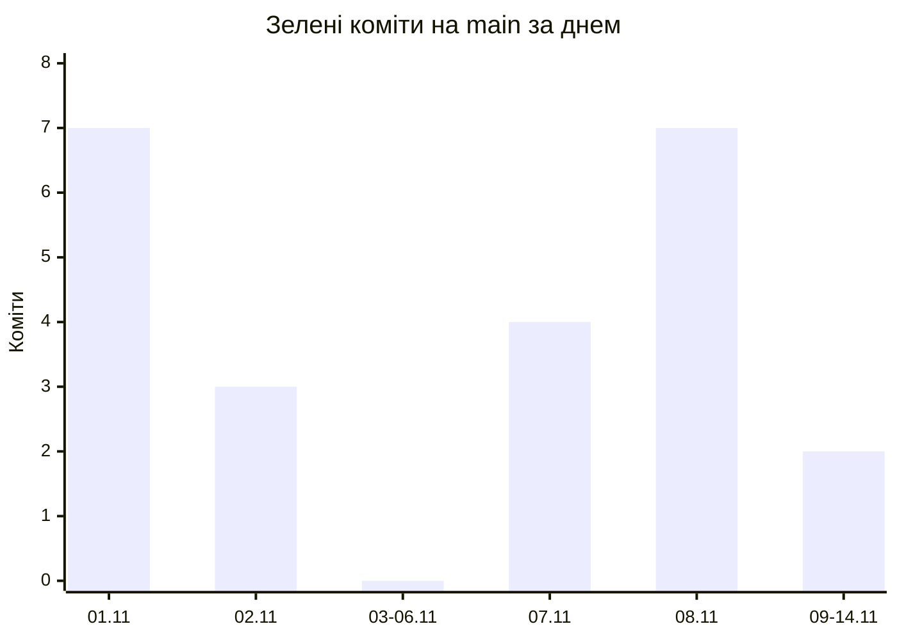
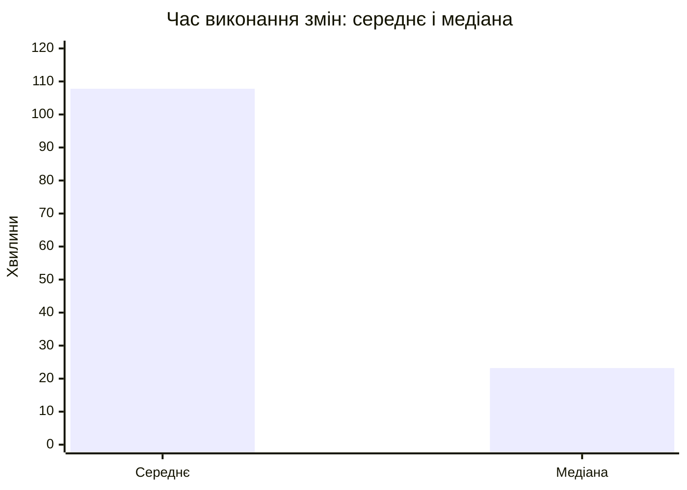
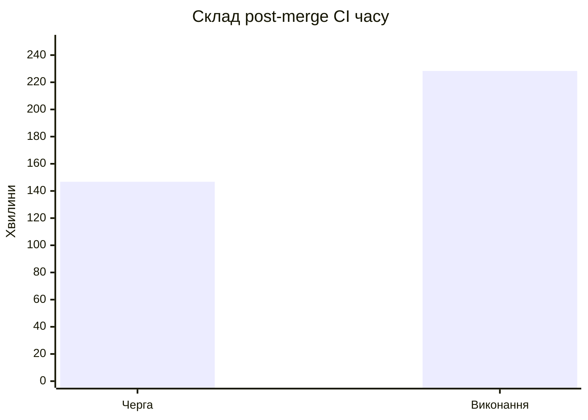

## Використання ШІ
- **Інструмент:** Copilot — допомога з аналізом CI/CD-даних і оформленням DORA-звіту.
- **Верифікація:** метрики, формули та висновки звірено з `metrics-raw.md` і фактичними запусками GitHub Actions.
- **Інструмент:** Claude Code — перелік врахованих workflow, розділи «Аналіз парами», «Першопричини», «Огляд інцидентів без пошуку винних», «План покращень» і бонус «Швидкий і повільний набори тестів» (зміна тригерів у `lab07-card-order.yml`).
- **Застосування:** збір підтверджень через `gh run list`, `gh run view --log-failed`, `gh api .../rules/branches/main` і `git diff --name-only` для кожного коміту вибірки; формулювання першопричин і дій.
- **Верифікація:** кожну цифру й причину збою перевірено вручну за посиланнями на запуски GitHub Actions і правилами гілки `main`; відповідальних за дії погоджено з командою.

# Підсумок метрик DORA

Це **єдиний основний розрахунок** за період 01.11–14.11.2026 за київським часом. У вибірці 23 commit-level записи на `main` і 83 workflow-запуски. Деталі кожного запису наведено в [metrics-raw.md](metrics-raw.md), докази API — у [evidence/main-runs-2026-11-01-to-2026-11-14.json](evidence/main-runs-2026-11-01-to-2026-11-14.json).

Розгортання – зелений запуск CI на `main` (визначення безперервної доставки з Лекції 10; у робоче середовище застосунок не розгортається, тож метрики — наближення). Commit вважається зеленим, якщо всі workflow, що запустилися для нього, завершилися успішно.

**Враховані workflow** (тригер `push` на `main`):

| Workflow | Файл | Job | Коли запускається на `main` |
|----------|------|-----|-----------------------------|
| CI | [ci.yml](../../.github/workflows/ci.yml) | `build`, `Reliability tests` | на кожен push |
| Static analysis | [static-analysis.yml](../../.github/workflows/static-analysis.yml) | `lint-and-security` | на кожен push |
| Lab07 card ordering | [lab07-card-order.yml](../../.github/workflows/lab07-card-order.yml) | `postgres-card-order` | на кожен push |
| Lab08 characterization tests | [lab08-characterization.yml](../../.github/workflows/lab08-characterization.yml) | `invitation-characterization` | лише за змін у `src/frontend/**` |
| Generate and Deploy API Docs | [deploy-api-docs.yml](../../.github/workflows/deploy-api-docs.yml) | `generate-and-deploy` | лише за змін у `src/api/**`, `docs/api/**`, `requirements.txt` |

Не враховано службові запуски GitHub, що не є нашими перевірками: `Dependency Graph` і `Dependabot Updates` (подія `dynamic`).

## Метрики DORA

| Метрика | Формула | Результат | Категорія (DORA 2025) |
|---------|---------|-----------|-----------------------|
| Частота розгортань | 23 зелені коміти / 2 тижні | 11,5 на тиждень (≈1,64 на день) | від щодня до щотижня → 44,6% |
| Час виконання змін | перший коміт PR → завершення зеленого запуску на `main` | середнє 107,8 хв, медіана 23,2 хв | за середнім: менше доби → 24,4%; за медіаною: менше години → 9,4% |
| Частота збоїв змін | 0 червоних / 23 завершені commit-level запуски × 100% | 0% | 0–2% → 8,5% |
| Час відновлення | червоний запуск на `main` → наступний зелений | н/д: red run у вибірці не було | н/д |

Частота була нерівномірною: 7 комітів 01.11, 3 — 02.11, 4 — 07.11, 7 — 08.11 і 2 — 09.11. Це вказує на групування роботи перед дедлайнами, а не на рівномірну доставку протягом двох тижнів.

## Порівняння з орієнтирами CircleCI

| Показник | Орієнтир | Дані 2025 року | Наше значення |
|----------|----------|----------------|---------------|
| Частка успішних запусків на `main` | 90% | 70,8% | 100% (23 з 23 commit-level записів) |
| Повернення `main` до зеленого стану | до 60 хв | 59,2 хв | н/д у вибірці |
| Тривалість workflow | до 10 хв | 2,2 хв (медіана) | 1,5 хв медіана commit-level execution, максимум 103,2 хв |

Максимальна тривалість виконання пов'язана з одночасними workflow та очікуванням self-hosted runner; тому медіана краще описує типовий запуск, а максимум — bottleneck, який не можна приховувати середнім.

## Склад часу виконання змін

| Частина | Сумарно, хв | Частка від повного lead time |
|---------|-------------|------------------------------|
| Від першого коміту до злиття PR (розробка й рецензування) | 2104,6 | 84,9% |
| Черга на runner | 146,8 | 5,9% |
| Виконання CI | 228,3 | 9,2% |

У межах лише CI (queue + execution) черга становить 39,1%, а виконання — 60,9%. Отже, найбільша частина повного lead time все одно виникає до merge, але runner queue є істотним технічним bottleneck у пікові моменти.

## Аналіз парами

Метрики DORA читаємо парами, бо будь-яку одну можна «покращити» ціною сусідньої.

| Пара | Що видно разом | Висновок |
|------|----------------|----------|
| **Швидкість:** частота розгортань + час виконання змін | 11,5 зелених комітів на тиждень (рівень «від щодня до щотижня», 44,6%) — але 14 з 23 припали на 01.11 і 08.11. Медіана часу виконання змін 23,2 хв, а середнє 107,8 хв: довгий хвіст дають PR, що чекали на злиття годинами (#194 ≈ 10 год), і вечір дедлайну 01.11, коли №5–7 стояли в черзі 26–54 хв | Частота висока лише в сумі за два тижні; насправді ми доставляємо сплесками. Саме в такі сплески найгірший і час виконання змін: зміни накопичуються до дедлайну, а потім разом чекають на огляд і на раннер |
| **Стабільність:** частота збоїв змін + час відновлення | 0% збоїв на `main` (рівень 0–2%, 8,5%) і н/д для відновлення. Водночас 6 червоних запусків на PR зупинили дефекти до злиття | Бар'єр до злиття працює, але процес відновлення ні разу не перевірено на практиці: немає ні відповідального, ні сповіщення про збій. Перший червоний запуск на `main` покаже реальний час відновлення, і зараз нічого не гарантує, що він буде меншим за 60 хв |
| **Швидкість × стабільність** | Стабільність не куплена повільністю: медіана виконання CI — 1,5 хв, на огляд і злиття припадає 84,9% часу виконання змін | Можна пришвидшити доставку (менші PR, щоденні злиття, огляд протягом дня), не послаблюючи перевірок. Але без вимоги актуальної гілки і з необов'язковим `postgres-card-order` частіші злиття підвищують ризик першого червоного запуску на `main`. Тому дії для швидкості й стабільності в плані покращень треба впроваджувати разом |

## Першопричини

### 🧩 Технічні

| Першопричина | Дані, що її підтверджують |
|--------------|---------------------------|
| Кожен коміт у `main` займає щонайменше 4 job на спільних раннерах: `build` і `Reliability tests` (CI), `postgres-card-order` (Lab07), `lint-and-security` (Static analysis); за змін у `src/` додаються ще API Docs і Lab08 | стовпець «Примітка» в [metrics-raw.md](metrics-raw.md) |
| Зміни лише в документації запускають повний набір перевірок | 12 з 23 комітів (52%) змінюють лише `docs/`, `Labs/` або `*.md` (`git diff --name-only`), але кожен запускав ті самі 4 job |
| Через це документаційні зміни стоять у черзі | №6 (#199, лише README і docs) і №7 (#200, лише Labs) чекали в черзі по 54,1 хв увечері 01.11, перед дедлайном |
| Немає `concurrency` і кешу залежностей: кожен job заново встановлює pip-залежності (а `Reliability tests` ще й npm), застарілі запуски не скасовуються | [ci.yml](../../.github/workflows/ci.yml), [static-analysis.yml](../../.github/workflows/static-analysis.yml) |
| Наше «виконання» включає очікування на раннер для job, які стартують пізніше першого | №5 (#198): 103,2 хв виконання при 26,3 хв черги; того вечора 5 workflow конкурували за раннер |

### 🤝 Організаційні та культурні

| Першопричина | Дані, що її підтверджують |
|--------------|---------------------------|
| Злиття пачками перед дедлайном | 14 з 23 комітів припали на 01.11 і 08.11; з 10.11 по 14.11 не було жодного злиття |
| PR довго чекають на огляд і злиття | 84,9% часу виконання змін припадає на період до злиття. П'ять PR (#194 ≈ 10 год, #229 ≈ 5,7 год, #199 ≈ 5,1 год, #230 ≈ 5,0 год, #200 ≈ 4,6 год) дають ≈ 74% сумарного часу виконання змін; медіана — лише 23,2 хв |
| Злиття пачками без вимоги, щоб гілка була актуальною відносно `main` | у ruleset для `main` вимкнено `strict_required_status_checks_policy` (`gh api repos/.../rules/branches/main`); 08.11 між 18:50 і 23:43 злито 7 PR |
| Не всі перевірки, що запускаються на PR, обов'язкові для злиття | required checks: `build`, `Reliability tests`, `lint-and-security`, `SonarCloud Code Analysis`; `postgres-card-order` (Lab07) і Lab08 не блокують злиття |
| Немає відповідального за стан конвеєра і сповіщень про збій на `main` | немає ні правила в документації команди, ні workflow зі сповіщенням |

## Огляд інцидентів без пошуку винних (blameless)

**Червоних запусків на `main` у період 01.11–14.11 не було**, тому частота збоїв змін — 0%, а час відновлення — н/д. Повторних запусків (`attempt > 1`) на `main` теж немає, тож ознак нестабільних тестів у цих даних не видно.

Відсутність червоних запусків на `main` ще не означає, що дефектів не було. Щоб побачити, що саме зупиняли перевірки, ми переглянули червоні запуски на PR за той самий період: **6 зі 222 запусків (2,7%), у 4 PR**. Усі дефекти виправлено до злиття, жоден не дійшов до `main`.

| PR | Запуск (час за Києвом) | Перевірка | Причина з логу | Що це означає |
|----|------------------------|-----------|----------------|---------------|
| #192 | [41247298083](https://github.com/ukma-fin-ssdm-2026/Monkey-Business-project/actions/runs/41247298083) (01.11 00:14) | CI → `build`, встановлення залежностей | `No matching distribution found for mutmut==2.5.1`: такої версії немає в PyPI | неіснуючу версію залежності помітили до злиття |
| #192 | [41248811331](https://github.com/ukma-fin-ssdm-2026/Monkey-Business-project/actions/runs/41248811331) (01.11 00:34) | CI → `build`, `Check for spec drift` | `docs/api/openapi-generated.yaml` у PR відрізнявся від згенерованого (вручну додано коментар-заголовок) | перевірка розбіжності специфікації працює |
| #202 | [41406965138](https://github.com/ukma-fin-ssdm-2026/Monkey-Business-project/actions/runs/41406965138) (02.11 09:32) | Static analysis → `detect-secrets` | `Secret Keyword` у `tests/reliability/test_database_failure.py:22` | тестовий пароль без позначки `pragma: allowlist secret` |
| #216 | [42358889467](https://github.com/ukma-fin-ssdm-2026/Monkey-Business-project/actions/runs/42358889467), [42359087655](https://github.com/ukma-fin-ssdm-2026/Monkey-Business-project/actions/runs/42359087655) (07.11 11:14, 11:17) | Static analysis → `detect-secrets` | `Secret Keyword` у `src/frontend/tests/reliability.test.tsx:56` і `:73` | те саме: тестові облікові дані, два запуски поспіль |
| #218 | [42387342929](https://github.com/ukma-fin-ssdm-2026/Monkey-Business-project/actions/runs/42387342929) (07.11 17:38) | Static analysis → `detect-secrets` | `The baseline file was updated. Please git add .secrets.baseline` | `.secrets.baseline` змінився, але його не закомітили |

**Висновки:**

1. **Жоден дефект не пройшов перевірки PR непоміченим**: обов'язкові перевірки (`build`, `lint-and-security`) спрацювали як бар'єр до злиття.
2. **4 з 6 червоних запусків — `detect-secrets`**, і всі вони відтворюються локально. Хук є в `.pre-commit-config.yaml`, але, судячи з даних, локально його не запускають, тож помилку знаходить CI вже після push. Кожен такий запуск — це зайві 4 job на спільних раннерах і довший час виконання змін.
3. **Яку перевірку варто додати:** не нову перевірку в CI, а запуск уже наявних хуків до push (`pre-commit install`). Для `main` найбільша прогалина — необов'язковий `postgres-card-order`: його збій не блокує злиття і став би першим червоним запуском на `main` (див. план покращень).

Історичний інцидент на `main` (18.10, запуски не стартували через обмеження білінгу GitHub) лежить поза періодом вибірки; його окремо розбирає колега в `incident-review.md`.

## Який біль у нашій команді показали ці метрики?

Після merge типовий pipeline швидкий: медіанний execution time становить 1,5 хв. Однак середній lead time — 107,8 хв, бо зміна довго очікує розробки, review та злиття. Стабільність у вибірці висока — 23 із 23 commit-level записів завершилися зеленими, але відсутність red main run не дає виміряти recovery time.

Пара «швидкість + стабільність» показує, що головний біль — не звичайне виконання тестів, а нерівномірний процес review/merge і пікове навантаження на runners. Пара «частота збоїв + відновлення» показує добрий бар'єр до merge, але відсутність фактичного recovery-сигналу та формалізованого сценарію реагування (детальніше — у розділі «Аналіз парами»).

## План покращень (Improvement Backlog)

Кожен рядок спирається на першопричину з даних (див. «Першопричини» вище). Команда з 4 осіб, тому дії лишаються пропозиціями; ефект кожної перевіряється тією самою метрикою на наступному періоді.

| Метрика | Проблема | Першопричина | Дія | Відповідальний |
|---------|----------|--------------|-----|----------------|
| Частота розгортань | 14 з 23 зелених комітів за 2 дні (01.11, 08.11); 10–14.11 — жодного | роботу над лабораторною відкладають до дедлайну | внутрішній дедлайн за 2 дні до пари; зливати щонайменше один PR у будні дні | @punguiin |
| Частота розгортань | лабораторну зливають одним PR наприкінці | робота над завданням не розбита на частини | розбивати лабораторну на 2–3 PR (дані → розрахунки → висновки) і зливати кожен, щойно він готовий | @saoleksii |
| Час виконання змін | 84,9% часу — до злиття; 5 PR дають ≈ 74% сумарного часу (найдовший #194 ≈ 10 год) | PR чекають на обов'язковий огляд (1 approve) | відкривати draft PR одразу після першого коміту; правило «огляд протягом робочого дня»; черговий рецензент на тиждень | @saoleksii |
| Час виконання змін | черга 54,1 хв для документаційних PR #199 і #200 | 52% комітів — лише документація, але кожен займає 4 job на спільних раннерах | для необов'язкового `Lab07 card ordering` — `paths-ignore` для `docs/**`, `Labs/**`, `**/*.md`; для обов'язкових `build`, `Reliability tests`, `lint-and-security` — пропуск кроків усередині job (фільтр на рівні workflow лишив би required check у стані «Expected — waiting») | @MykolaVashchenko |
| Час виконання змін | виконання до 103,2 хв (№5), 38,9 хв (№7) | job не кешують залежності, застарілі запуски PR не скасовуються | `concurrency` з `cancel-in-progress: true` для PR; `cache: pip` у `setup-python` і `cache: npm` у `setup-node` | @MykolaVashchenko |
| Час виконання змін | 6 червоних запусків на PR, 4 з них — `detect-secrets` | хуки pre-commit не запускають локально, тож помилку знаходить CI після push | `pre-commit install` в інструкції для команди (README); тестові облікові дані одразу позначати `pragma: allowlist secret` | @MykolaVashchenko |
| Частота збоїв змін | 0%, але 7 злиттів за вечір 08.11 | ruleset не вимагає, щоб гілка була актуальною відносно `main` | увімкнути «Require branches to be up to date before merging» | @mytec0l |
| Частота збоїв змін | дефект у тестах з PostgreSQL може потрапити в `main` | `postgres-card-order` (Lab07) не входить у required checks | ~~додати до required checks~~ → **змінено рішення:** повільний набір винесено на `main` (див. «Бонуси»), бо так менше навантаження на спільні раннери. Ризик закриваємо інакше: перед злиттям змін у `src/api/repositories/`, `migrations/` чи `tests/integration/` запускати набір вручну (`workflow_dispatch`); червоний `postgres-card-order` на `main` обробляємо за правилом відновлення (60 хв) | @MykolaVashchenko |
| Час відновлення | н/д у листопаді; немає сценарію реакції на збій | немає відповідального за стан конвеєра | черговий за конвеєром на тиждень; правило: червона `main` → revert або виправлення протягом 60 хв (орієнтир CircleCI) | @mytec0l |
| Час відновлення | збій на `main` можуть помітити із запізненням | немає сповіщень про червоний запуск на `main` | сповіщення про `failure` на `main` у командний чат (GitHub-інтеграція або крок у workflow) | @punguiin |

## DORA dashboard

Цей графік показує **deployment frequency** та її нерівномірність.

Цей графік показує **change lead time**. Велика різниця між середнім і медіаною означає, що кілька довгих змін сильно збільшують середнє значення.

Цей графік показує, як post-merge CI час розділяється на **queue time** і **execution time**. У межах CI queue займає 39,1%, execution — 60,9%.

Стабільність показана в таблиці метрик вище: **23/23 зелених commit-level записів, 0% change fail rate**. Recovery time має значення н/д, тому окремий графік для нього не будується — у вибірці не було red run, з якого можна було б обчислити відновлення.

### Один ключовий висновок

Ми доставляємо зміни нерівномірними групами: 7 зелених комітів припали на 01.11 і ще 7 — на 08.11. Після merge типовий pipeline швидкий (медіана execution time — 1,5 хв), але середній lead time становить 107,8 хв через очікування до merge; queue також займає 39,1% post-merge CI часу.

### Одна дія до наступного тижня

Відкривати draft PR одразу після першого коміту та встановити правило командного review протягом робочого дня. Ефект перевірити наступного тижня за медіаною lead time і кількістю комітів у `main` по днях.

## Пропозиції для CI/CD практик

1. Відкривати draft PR одразу після першого коміту та встановити домовленість про review протягом дня.
2. Переглянути тригери й concurrency workflow, щоб документаційні зміни та паралельні jobs не створювали зайву конкуренцію за self-hosted runners.

## Бонуси

### Швидкий і повільний набори тестів (§2.3.6)

**Що зроблено:** з [lab07-card-order.yml](../../.github/workflows/lab07-card-order.yml) прибрано тригер `pull_request`; додано `workflow_dispatch` для ручного запуску. Більше нічого змінювати не довелося: інтеграційні тести вже пропускаються без `TEST_DATABASE_URL`, тому в job `build` вони не виконуються.

| Набір | Що входить | Де запускається | Залежність | Workflow → job |
|-------|------------|-----------------|------------|----------------|
| Швидкий | модульні тести й тести API через `TestClient` із репозиторієм у пам'яті (`tests/`, крім тестів, що потребують PostgreSQL), поріг покриття 70% | кожен PR і кожен push у `main` | немає | CI → `build` |
| Повільний | `tests/integration/` (TP-02, TP-06, TP-10, TP-11) і `tests/test_card_order_postgres.py` (TP-04); job також повторно запускає `tests/test_card_order.py`, який уже входить у швидкий набір | лише push у `main` і вручну (`workflow_dispatch`) | **PostgreSQL 16 у контейнері** (`services: postgres`), схема — міграціями Alembic | Lab07 card ordering → `postgres-card-order` |

**Як поділ працює технічно:** фікстури в [tests/integration/conftest.py](../../tests/integration/conftest.py) і [tests/test_card_order_postgres.py](../../tests/test_card_order_postgres.py) викликають `pytest.skip`, якщо не задано `TEST_DATABASE_URL`. У `build` змінна не задана, тож ці тести пропускаються; у `postgres-card-order` вона вказує на сервісний контейнер PostgreSQL.

**Докази:**

| Запуск | Посилання | Набори | Тривалість |
|--------|-----------|--------|------------|
| PR лише зі швидким набором | _TODO: посилання на запуск CI цього PR_ | швидкий | _TODO_ |
| `main` з обома наборами | _TODO: посилання на запуски CI і Lab07 після злиття_ | швидкий + повільний | _TODO_ |

Орієнтир до зміни (3 останні запуски на `main`): job `postgres-card-order` — 56–91 с, з них самі тести — 5–12 с. Решта — старт контейнера PostgreSQL і встановлення залежностей. Поділ звільняє один раннер приблизно на хвилину на кожен push у PR.

**Ціна поділу:** дефект, який ловить лише повільний набір, тепер з'явиться як червоний запуск на `main` і увійде в частоту збоїв змін (див. рядок у плані покращень).
