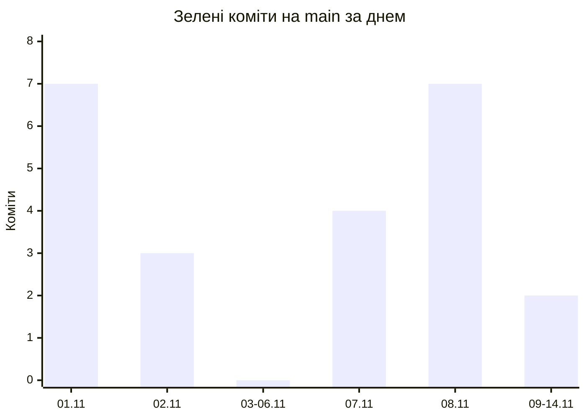
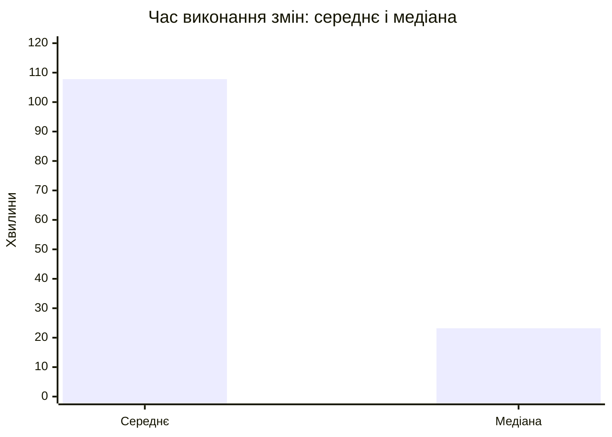
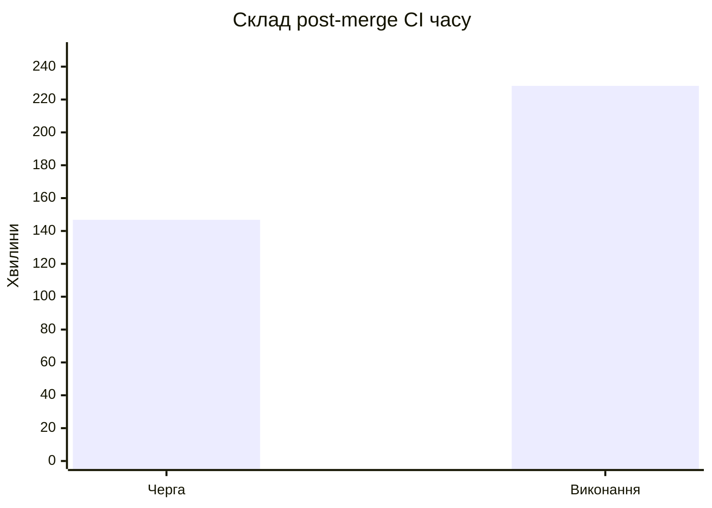

## Використання ШІ
- **Інструмент:** Copilot — допомога з аналізом CI/CD-даних і оформленням DORA-звіту.
- **Верифікація:** метрики, формули та висновки звірено з `metrics-raw.md` і фактичними запусками GitHub Actions.

# Підсумок метрик DORA

Це **єдиний основний розрахунок** за період 01.11–14.11.2026 за київським часом. У вибірці 23 commit-level записи на `main` і 83 workflow-запуски. Деталі кожного запису наведено в [metrics-raw.md](metrics-raw.md), докази API — у [evidence/main-runs-2026-11-01-to-2026-11-14.json](evidence/main-runs-2026-11-01-to-2026-11-14.json).

Розгортання – зелений запуск CI на `main`. Commit вважається зеленим, якщо всі workflow, що запустилися для нього, завершилися успішно.

## Метрики DORA

| Метрика | Формула | Результат | Категорія (DORA 2025) |
|---------|---------|-----------|-----------------------|
| Частота розгортань | 23 зелені коміти / 2 тижні | 11,5 на тиждень (≈1,64 на день) | від щодня до щотижня → 44,6% |
| Час виконання змін | перший коміт PR → завершення зеленого запуску на `main` | середнє 107,8 хв, медіана 23,2 хв | за середнім: менше доби → 24,4%; за медіаною: менше години → 9,4% |
| Частота збоїв змін | 0 червоних / 23 завершені commit-level запуски × 100% | 0% | 0–2% → 8,5% |
| Час відновлення | червоний запуск на `main` → наступний зелений | н/д: red run у вибірці не було | н/д |

Частота була нерівномірною: 7 комітів 01.11, 3 — 02.11, 4 — 07.11, 7 — 08.11 і 2 — 09.11. Це вказує на групування роботи перед дедлайнами, а не на рівномірну доставку протягом двох тижнів.

## Порівняння з орієнтирами CircleCI

| Показник | Орієнтир | Дані 2025 року | Наше значення |
|----------|----------|----------------|---------------|
| Частка успішних запусків на `main` | 90% | 70,8% | 100% (23 з 23 commit-level записів) |
| Повернення `main` до зеленого стану | до 60 хв | 59,2 хв | н/д у вибірці |
| Тривалість workflow | до 10 хв | 2,2 хв (медіана) | 1,5 хв медіана commit-level execution, максимум 103,2 хв |

Максимальна тривалість виконання пов'язана з одночасними workflow та очікуванням self-hosted runner; тому медіана краще описує типовий запуск, а максимум — bottleneck, який не можна приховувати середнім.

## Склад часу виконання змін

| Частина | Сумарно, хв | Частка від повного lead time |
|---------|-------------|------------------------------|
| Від першого коміту до злиття PR (розробка й рецензування) | 2104,6 | 84,9% |
| Черга на runner | 146,8 | 5,9% |
| Виконання CI | 228,3 | 9,2% |

У межах лише CI (queue + execution) черга становить 39,1%, а виконання — 60,9%. Отже, найбільша частина повного lead time все одно виникає до merge, але runner queue є істотним технічним bottleneck у пікові моменти.

## Першопричини

**Технічні:** кілька workflow і два job у `CI` запускаються для одного commit на спільних self-hosted runners. Це пояснює чергу та довгі максимальні execution times. Workflow запускається навіть для змін, які не потребують повного набору перевірок.

**Організаційні:** PR і коміти зливаються пачками: найбільші групи припали на 01.11 і 08.11. Для частини PR перший коміт був зроблений задовго до відкриття або злиття PR, тому до 84,9% lead time припадає на розробку та review, а не на CI.

**Огляд інцидентів:** у цій основній вибірці червоних запусків на `main` не було. Тому recovery time має значення н/д.

## Який біль у нашій команді показали ці метрики?

Після merge типовий pipeline швидкий: медіанний execution time становить 1,5 хв. Однак середній lead time — 107,8 хв, бо зміна довго очікує розробки, review та злиття. Стабільність у вибірці висока — 23 із 23 commit-level записів завершилися зеленими, але відсутність red main run не дає виміряти recovery time.

Пара «швидкість + стабільність» показує, що головний біль — не звичайне виконання тестів, а нерівномірний процес review/merge і пікове навантаження на runners. Пара «частота збоїв + відновлення» показує добрий бар'єр до merge, але відсутність фактичного recovery-сигналу та формалізованого сценарію реагування.

## План покращень (Improvement Backlog)

| Метрика | Проблема | Першопричина | Дія | Відповідальний |
|---------|----------|--------------|-----|----------------|
| Deployment frequency | великі групи злиттів 01.11 і 08.11 | роботу відкладають до дедлайну | зливати менші PR рівномірно протягом тижня | @punguiin |
| Lead time | середнє 107,8 хв проти медіани 23,2 хв | довге очікування до merge | відкривати draft PR одразу після першого коміту та домовитися про review протягом дня | @saoleksii |
| Lead time | 39,1% post-merge CI часу — queue | спільні self-hosted runners і паралельні workflow | переглянути concurrency та тригери workflow, не послаблюючи required checks | @MykolaVashchenko |
| Lead time | максимальний execution time 103,2 хв | кілька workflow/jobs конкурують за runner | не запускати непотрібні перевірки для документаційних змін там, де це сумісно з branch protection | @MykolaVashchenko |
| Change fail rate | 0% у вибірці, але немає доказу нульового ризику | усі перевірки можуть не покривати дефекти після merge | залишити reliability checks required для PR і перевірити актуальність branch protection | @MykolaVashchenko |
| Recovery time | н/д | у періоді не було red main run | призначити відповідального за pipeline та зафіксувати rollback/fix протягом 60 хв | @mytec0l |
| Recovery time | можливе пізнє виявлення проблеми | немає явного сповіщення команди | налаштувати сповіщення при failure на `main` | @punguiin |
| Change fail rate | ризик зламати `main` при пачці злиттів | PR може бути застарілим відносно `main` | увімкнути вимогу «branch up to date» перед merge | @mytec0l |
| Change fail rate | дефект може пройти вузький набір PR-перевірок | повільні або reliability-тести не є обов'язковими для всіх потрібних змін | залишити reliability checks required і перевірити branch protection | @MykolaVashchenko |

## DORA dashboard

Цей графік показує **deployment frequency** та її нерівномірність.

Цей графік показує **change lead time**. Велика різниця між середнім і медіаною означає, що кілька довгих змін сильно збільшують середнє значення.

Цей графік показує, як post-merge CI час розділяється на **queue time** і **execution time**. У межах CI queue займає 39,1%, execution — 60,9%.

Стабільність показана в таблиці метрик вище: **23/23 зелених commit-level записів, 0% change fail rate**. Recovery time має значення н/д, тому окремий графік для нього не будується — у вибірці не було red run, з якого можна було б обчислити відновлення.

### Один ключовий висновок

Ми доставляємо зміни нерівномірними групами: 7 зелених комітів припали на 01.11 і ще 7 — на 08.11. Після merge типовий pipeline швидкий (медіана execution time — 1,5 хв), але середній lead time становить 107,8 хв через очікування до merge; queue також займає 39,1% post-merge CI часу.

### Одна дія до наступного тижня

Відкривати draft PR одразу після першого коміту та встановити правило командного review протягом робочого дня. Ефект перевірити наступного тижня за медіаною lead time і кількістю комітів у `main` по днях.

## Пропозиції для CI/CD практик

1. Відкривати draft PR одразу після першого коміту та встановити домовленість про review протягом дня.
2. Переглянути тригери й concurrency workflow, щоб документаційні зміни та паралельні jobs не створювали зайву конкуренцію за self-hosted runners.
