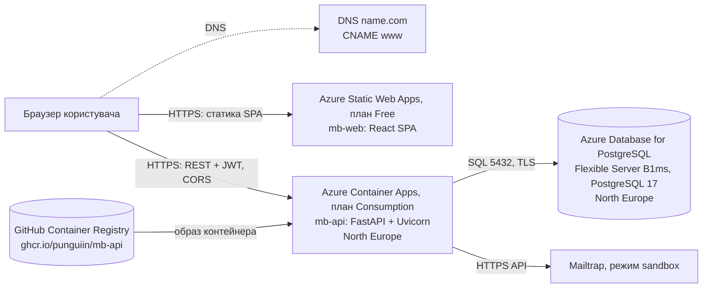

# Розгортання в Azure

Документ описує, як **Tech Interview Board** розгорнуто зараз і як оновлювати розгортання. Стан на 01.11.2026: версія API `0.1.7`, образ зібрано з коміту `4eb3035` (злиття PR #197).

Цільову архітектуру виробничого середовища (VPS, nginx, моніторинг, резервні копії в S3) описано в [діаграмі розгортання](architecture/uml/deployment-diagram.puml). Поточне розгортання — спрощений варіант на керованих сервісах Azure у межах безкоштовних лімітів.

## Публічні адреси

| Що | Адреса |
|---|---|
| Застосунок | https://www.interviewboard.app |
| Застосунок (стандартна адреса Azure) | https://gentle-rock-0655cc303.6.azurestaticapps.net |
| Backend API | https://mb-api.calmmeadow-96006ddf.northeurope.azurecontainerapps.io |
| Swagger UI розгорнутого API | https://mb-api.calmmeadow-96006ddf.northeurope.azurecontainerapps.io/api-docs |
| Перевірка стану API | https://mb-api.calmmeadow-96006ddf.northeurope.azurecontainerapps.io/health |

Працездатність перевірено 01.11.2026:
- `/health` повертає `200 {"status":"ok"}`, `/openapi.json` — версію `0.1.7`;
- маршрути SPA `/board` і `/invitations/<token>` відкриваються напряму (без 404);
- CORS-запит до API дозволено з обох адрес фронтенду;
- реєстрацію, створення дошки й картки та запрошення ментора (лист надходить у скриньку Mailtrap) перевірено вручну в браузері.

## Схема



Браузер завантажує SPA зі Static Web Apps і далі звертається до API напряму. API працює на іншому origin, тому потрібен CORS. API підключається до PostgreSQL через TLS, а листи-запрошення менторам надсилає через Mailtrap.

## Ресурси Azure

Підписка — Azure Free Trial з увімкненим лімітом витрат. Усі ресурси розміщено в групі `monkey-business`.

| Ресурс | Тип | Регіон | Конфігурація |
|---|---|---|---|
| `mb-pg-nsydorchuk` | Azure Database for PostgreSQL, Flexible Server | North Europe | Burstable `Standard_B1ms`, 32 GiB, PostgreSQL 17, HA вимкнено, автоматичні резервні копії 7 днів, база `interview_board` |
| `mb-env` | Container Apps Environment | North Europe | план Consumption, журнали не зберігаються (`--logs-destination none`) |
| `mb-api` | Container App | North Europe | образ `ghcr.io/punguiin/mb-api:4eb3035`, 0.25 vCPU / 0.5 GiB, 0–1 репліка, зовнішній ingress на порт 8000 |
| `mb-web` | Static Web App | West Europe (контент роздається глобально) | план Free, домени `www.interviewboard.app` і стандартний `*.azurestaticapps.net` |

PostgreSQL розміщено в North Europe, бо Free Trial не дозволив створити сервер у West Europe (`The location is restricted from performing this operation`). API працює в тому ж регіоні, що й база.

**Домен.** `interviewboard.app` зареєстровано на name.com. У DNS налаштовано запис `CNAME www → gentle-rock-0655cc303.6.azurestaticapps.net`. TLS-сертифікат видає Azure автоматично. Домен без `www` не налаштовано.

## Конфігурація

### API

Змінні середовища контейнера `mb-api`:

| Змінна | Джерело | Значення / призначення |
|---|---|---|
| `DATABASE_URL` | секрет `db-url` | `postgresql+psycopg://<адмін>:<пароль>@mb-pg-nsydorchuk.postgres.database.azure.com:5432/interview_board?sslmode=require` |
| `JWT_SECRET` | секрет `jwt-secret` | випадковий ключ підпису токенів (`openssl rand -hex 32`) |
| `FRONTEND_URL` | звичайна змінна | `https://www.interviewboard.app` — база посилань у листах-запрошеннях |
| `MAILTRAP_API_TOKEN` | секрет `mailtrap` | токен Mailtrap API з доступом до sandbox-скриньки `4439163`; без нього запрошення менторів завершуються помилкою |

Значення секретів зберігаються лише в Azure, у репозиторії їх немає. Пароль адміністратора БД зберігає власник підписки.

Під час старту контейнер виконує `alembic upgrade head` і запускає uvicorn на порту 8000 від непривілейованого користувача `app` (див. [`Dockerfile`](../Dockerfile)). Реплік не більше однієї, тому міграції не запускаються паралельно. Після 300 с без запитів кількість реплік зменшується до нуля. Перший запит після паузи чекає на холодний старт: запуск контейнера й перевірку міграцій.

### Фронтенд

- `VITE_API_BASE_URL` задається під час збірки й дорівнює адресі API.
- [`src/frontend/public/staticwebapp.config.json`](../src/frontend/public/staticwebapp.config.json) повертає `index.html` для маршрутів SPA (`/board`, `/invitations/...`), тому оновлення сторінки не дає 404.

### CORS

Бекенд не підключає `CORSMiddleware`, тому CORS налаштовано на рівні ingress Container Apps:
- origins — обидві адреси фронтенду;
- методи — `GET`, `POST`, `PUT`, `PATCH`, `DELETE`, `OPTIONS`;
- заголовки — `Authorization`, `Content-Type`.

Токен передається в заголовку `Authorization`, cookies не використовуються, тому `allowCredentials` вимкнено.

## Оновлення розгортання

Розгортання виконується вручну. CI ([`ci.yml`](../.github/workflows/ci.yml) та інші workflow у `.github/workflows/`) запускає тести й збірку для PR і `main`. Автоматично розгортається лише документація API на GitHub Pages ([`deploy-api-docs.yml`](../.github/workflows/deploy-api-docs.yml)).

Команди `az` виконуються в Azure Cloud Shell (Bash) або локально після `az login`. Потрібна роль Contributor на групі `monkey-business`.

### Backend

Для публікації образу потрібно увійти в GHCR (`docker login ghcr.io`) з classic-токеном GitHub зі scope `write:packages`. Після злиття змін у `main` локально виконати:

```bash
git switch main && git pull
TAG=$(git rev-parse --short HEAD)
docker build -t ghcr.io/punguiin/mb-api:$TAG .
docker push ghcr.io/punguiin/mb-api:$TAG
```

Далі переключити контейнер на новий образ:

```bash
az containerapp update -g monkey-business -n mb-api --image ghcr.io/punguiin/mb-api:<TAG>
```

Нова ревізія застосовує міграції під час старту. Для відкату достатньо виконати ту саму команду з попереднім тегом. Список ревізій: `az containerapp revision list -g monkey-business -n mb-api -o table`.

### Frontend

```bash
cd src/frontend
npm ci
VITE_API_BASE_URL=https://mb-api.calmmeadow-96006ddf.northeurope.azurecontainerapps.io npx vite build
read -rs SWA_CLI_DEPLOYMENT_TOKEN && export SWA_CLI_DEPLOYMENT_TOKEN
docker run --rm -v "$PWD/dist:/app/dist:ro" -w /app -e SWA_CLI_DEPLOYMENT_TOKEN node:22 \
  npx --yes @azure/static-web-apps-cli deploy ./dist --env production
```

- **Токен розгортання** видає команда `az staticwebapp secrets list -g monkey-business -n mb-web --query properties.apiKey -o tsv`. Його не можна комітити чи публікувати.
- **SWA CLI запускається в контейнері `node:22`**, щоб його вбудований бінарний файл не залежав від бібліотек локальної системи (наприклад, NixOS).
- **`npx vite build` замість `npm run build`**: так не змінюється відстежуваний `tsconfig.tsbuildinfo`. Перевірку типів (`npm run build`) виконує CI у [`lab08-characterization.yml`](../.github/workflows/lab08-characterization.yml).

## Журнали та діагностика

```bash
az containerapp logs show -g monkey-business -n mb-api --follow --tail 100
az containerapp logs show -g monkey-business -n mb-api --type system --tail 50
az containerapp exec -g monkey-business -n mb-api --command sh
```

Команди за порядком:
1. вивід застосунку: запити uvicorn, міграції, трасування помилок;
2. події платформи: завантаження образу, запуск ревізій, перезапуски;
3. оболонка всередині запущеного контейнера.

Журнали доступні лише в реальному часі й лише поки працює репліка, історія не зберігається. Щоб зберігати історію, середовище `mb-env` можна під'єднати до Log Analytics (перші 5 GB на місяць безкоштовні).

## Доступ команди

Власник підписки надає доступ обліковим записам `@ukma.edu.ua`:

```bash
az role assignment create --assignee <email>@ukma.edu.ua --role Contributor \
  --scope $(az group show -n monkey-business --query id -o tsv)
```

Роль Contributor дає змогу переглядати журнали, оновлювати образ і налаштування. Водночас вона дозволяє читати секрети й видаляти ресурси групи. Роль Reader дає лише перегляд, без потокових журналів.

## Вартість і ліміти

| Сервіс | Що безкоштовно |
|---|---|
| Container Apps (Consumption) | Щомісяця 180 000 vCPU-с, 360 000 GiB-с і 2 млн запитів, без обмеження строку. Коли реплік нуль, оплата не нараховується. За 0.25 vCPU / 0.5 GiB це близько 200 активних годин на місяць. |
| PostgreSQL B1ms | 750 год на місяць і 32 GB сховища протягом 12 місяців від створення облікового запису Azure |
| Static Web Apps | план Free |
| Підписка Free Trial | Кредит $200 на 30 днів. Ліміт витрат увімкнено, тому списань з картки немає. Після 30 днів підписку вимкнуть, якщо не перейти на pay-as-you-go. Безкоштовні обсяги вище після переходу зберігаються. |
| Домен | $0 за перший рік, далі $26.99 на рік |

## Відомі обмеження

- **Немає автоматичного розгортання (CD)**: оновлення виконуються вручну за кроками вище.
- **Образ у персональному реєстрі** `ghcr.io/punguiin`: інші учасники не можуть публікувати нові образи.
- **Mailtrap у режимі sandbox**: листи-запрошення потрапляють у тестову скриньку Mailtrap (`inbox_id=4439163`), а не на реальну пошту ментора.
- **Журнали не зберігаються**; моніторинг (Prometheus/Grafana з [ADR-003](architecture/decisions/ADR-003.md)) не розгорнуто.
- **Сервер БД має публічну адресу**: firewall пропускає всі IP-адреси Azure, а не лише наші ресурси. Захист — пароль і TLS.
- **Холодний старт**: перший запит після простою відповідає повільніше.
- **Домен без `www`** не налаштовано.
- **Free Trial** діє 30 днів від реєстрації.

## Відтворення з нуля

1. Зареєструвати провайдерів ресурсів (один раз на підписку):

   ```bash
   for ns in Microsoft.App Microsoft.OperationalInsights Microsoft.DBforPostgreSQL Microsoft.Web; do
     az provider register --namespace $ns
   done
   ```

2. Створити базу даних:

   ```bash
   RG=monkey-business; LOC=northeurope; PG=mb-pg-nsydorchuk
   PGPASS="Mb1$(openssl rand -hex 16)"
   az group create -n $RG -l westeurope
   az postgres flexible-server create -g $RG -n $PG -l $LOC \
     --tier Burstable --sku-name Standard_B1ms --storage-size 32 --version 17 \
     --admin-user <адмін> --admin-password "$PGPASS" --public-access 0.0.0.0 --yes
   az postgres flexible-server db create -g $RG --server-name $PG --name interview_board
   ```

3. Зібрати й опублікувати образ (розділ [Backend](#backend)) і зробити пакет у GHCR публічним.

4. Створити API:

   ```bash
   az extension add -n containerapp --upgrade --only-show-errors
   az containerapp env create -g $RG -n mb-env -l $LOC --logs-destination none
   DBURL="postgresql+psycopg://<адмін>:$PGPASS@$PG.postgres.database.azure.com:5432/interview_board?sslmode=require"
   az containerapp create -g $RG -n mb-api --environment mb-env \
     --image ghcr.io/punguiin/mb-api:<TAG> --target-port 8000 --ingress external \
     --cpu 0.25 --memory 0.5Gi --min-replicas 0 --max-replicas 1 \
     --secrets "db-url=$DBURL" "jwt-secret=$(openssl rand -hex 32)" \
     --env-vars DATABASE_URL=secretref:db-url JWT_SECRET=secretref:jwt-secret
   ```

5. Створити фронтенд, налаштувати CORS і домен:

   ```bash
   az staticwebapp create -g $RG -n mb-web -l westeurope --sku Free
   WEB=$(az staticwebapp show -g $RG -n mb-web --query defaultHostname -o tsv)
   az containerapp ingress cors enable -g $RG -n mb-api \
     --allowed-origins https://$WEB https://www.interviewboard.app \
     --allowed-methods GET POST PUT PATCH DELETE OPTIONS --allowed-headers Authorization Content-Type
   az containerapp update -g $RG -n mb-api --set-env-vars FRONTEND_URL=https://www.interviewboard.app
   az staticwebapp hostname set -g $RG -n mb-web --hostname www.interviewboard.app
   ```

   Команду `hostname set` виконувати після створення CNAME-запису `www` у DNS.

6. Зібрати й розгорнути фронтенд (розділ [Frontend](#frontend)).

7. Додати токен Mailtrap:

   ```bash
   az containerapp secret set -g $RG -n mb-api --secrets "mailtrap=<токен>"
   az containerapp update -g $RG -n mb-api --set-env-vars MAILTRAP_API_TOKEN=secretref:mailtrap
   ```

Особливості актуальної версії Azure CLI, виявлені під час налаштування:
- прапорця `--high-availability` більше немає (HA за замовчуванням вимкнено);
- `db create` приймає назву бази через `--name`;
- прапорець `--storage-size` слід задавати явно, бо за замовчуванням виділяється 128 GiB, що виходить за безкоштовний обсяг.

## Відповідність вимогам проміжного оцінювання

Вимоги взято зі сторінки [«Проміжне оцінювання проєкту»](https://ssdm-2026.cs-courses.org/midterm-evaluation.html).

| Вимога | Де виконано |
|---|---|
| [«1. Оцінювання документації (8 балів)»](<https://ssdm-2026.cs-courses.org/midterm-evaluation.html#1._Оцінювання_документації_(8_балів)_0>), критерій 5 «Інструкції запуску (локально/розгорнуто)» | Локальний запуск — [`src/api/README.md`](../src/api/README.md), [`src/frontend/README.md`](../src/frontend/README.md). Онлайн-доступ — розділ «Розгорнута версія» в [`README.md`](../README.md) і цей документ. |
| [«2. Оцінювання запуску та демонстрації проєкту (7 балів)»](<https://ssdm-2026.cs-courses.org/midterm-evaluation.html#2._Оцінювання_запуску_та_демонстрації_проєкту_(7_балів)_0>), рівень «Зовнішнє розгортання» | https://www.interviewboard.app |
| [«3. Примітки щодо подання»](<https://ssdm-2026.cs-courses.org/midterm-evaluation.html#3._Примітки_щодо_подання_0>): конфігурація CI/CD видима в репозиторії, документація відповідає поточному стану | CI — [`.github/workflows/`](../.github/workflows/). Процес розгортання описано в цьому документі (ручний, без CD-конфігурації). |

## Використання ШІ
- **Інструмент:** Claude Code
- **Застосування:** підготовка покрокового розгортання в Azure (команди `az`, налаштування CORS і домену) та написання цього документа за фактичним станом ресурсів.
- **Верифікація:**
  - команди виконано вручну в Azure Cloud Shell 01.11.2026, результати звірено з виводом `az`;
  - адреси, CORS і маршрути SPA перевірено HTTP-запитами до розгорнутих сервісів;
  - роботу застосунку (реєстрація, дошка, картка, запрошення ментора через Mailtrap) перевірено вручну в браузері.
